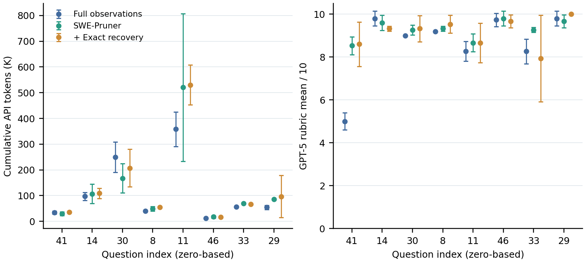
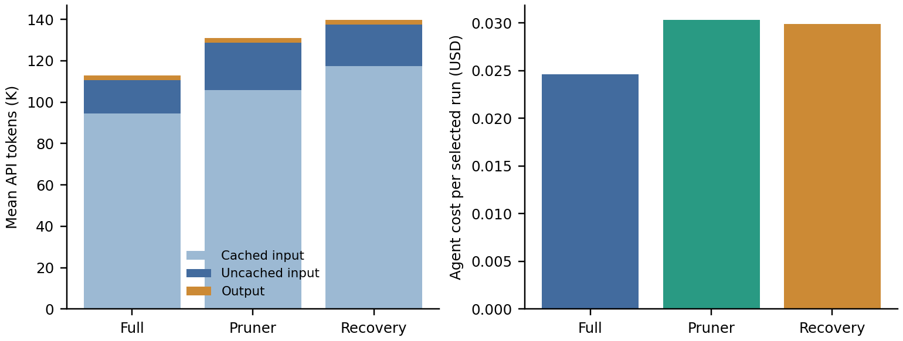

# SWE-Pruner: Reproduction and Exact Recovery

Xia Feifan · 1155204948

FTEC5660 Individual Reproducibility Project · 11 November 2026

## Abstract

We run the released SWE-Pruner/OpenHands pipeline and checkpoint with GLM-4.6 on eight fixed Streamlink questions, three conditions and three executions: 72 completed cells. Full, pruned and recoverable observations score 8.63, 9.27 and 9.13, using 112.8K, 131.0K and 139.8K cumulative tokens. Pruning increases tokens by 16.1%, contrasting with the paper's 54.4% decrease. Activation, long outputs and subsequent investigation explain the local discrepancy. Our isolated modification adds task-scoped original-observation storage and bounded exact range recovery. A separate 72-cell goal-shift experiment improves exact matches from 3/24 after pruning to 24/24 with recovery, with additional context cost. Evidence accessibility is demonstrated; retrieval decisions determine the end-to-end trade-off.

## 1. Introduction

Coding agents repeatedly search and read repositories. A long tool response can remain in conversation history and be transmitted again in subsequent requests. SWE-Pruner filters such responses using an agent-supplied focus question and a released 0.6B neural skimmer [1,2]. This project, item 26 on the instructor's list, runs the authors' OpenHands/SWE-QA pipeline on Streamlink and examines its quality/resource trade-off.

Table 2 of SWE-Pruner reports lower cumulative token usage with unchanged GLM-4.6 quality on Streamlink [1]. This finding connects local observation compression to a complete agent investigation: shorter tool responses can change subsequent reading decisions, interaction counts and conversation history. We examine this trade-off using the matching model identifier, released weights and author evaluation pipeline. Published and reproduced values appear together in Table 3.

We also study access to evidence after pruning. As an investigation develops, material removed under an earlier focus question can become relevant. We extend the original pipeline with task-scoped storage and bounded exact recovery, then measure both autonomous repository QA and evidence access under a fixed goal-shift intervention.

The main experiment uses the matching GLM-4.6 model identifier, released skimmer weights and author pipeline on eight predefined questions, with three executions per condition. A separate fixed-context experiment tests recovery after a change in investigation goal. The main experiment measures autonomous task behavior; the second isolates access to evidence removed from a saved observation.

The study contributes a complete three-condition comparison with request-level analysis of discrepancies, a reusable exact-recovery interface, and complementary autonomous and fixed-context evidence characterizing its benefits and costs.

<!-- page -->

## 2. Method

### 2.1 Goal-conditioned pruning and exact recovery

Pruning responds to the current focus question. A later investigation step may require a field, boundary condition or type definition that was previously irrelevant. Retaining the captured original observation provides another way to retrieve such evidence, particularly when the original tool is slow, remote or difficult to repeat.

The primary modification is task-scoped lossless observation recovery. A store retains each captured Bash response. The agent receives the authors' pruned result plus an observation ID and line count, and can call `expand(observation_id, start, end)`. Ranges are inclusive, one-based and limited to 200 observation lines per call. Returned characters, repeated lines and expansion actions are logged.

Table 1. Exact-recovery interface and verification evidence.

| Step | Interface behavior | Evidence |
| --- | --- | --- |
| Capture | Store original text under a content ID | ID matches SHA-256 prefix |
| Prune | Released weights, focus question, threshold 0.5 | Raw service response and retained tokens |
| Expose handle | Append ID and observation line count | Complete conversation trace |
| Expand | Return original range without rerunning the tool | Exact stored-text slice |
| Account | Record range, characters and repeated lines | Store manifest and API usage |

Exactness is defined over the captured tool text. The original Bash executor strips outer stdout whitespace, so the contract starts after that capture step. File line numbers printed by `cat -n` and observation-range coordinates are separate.

### 2.2 Mechanism and resource implications

Recovery may repair missing evidence and reduce repeated searches. It also adds storage, an index in the prompt, a tool schema and potentially more model turns. The autonomous comparison measures uptake and the resulting quality/resource trade-off. The fixed-context experiment directly tests access to missing evidence after a goal change.

A pre-run integration check pruned a 6,959-token response to 693 tokens and recovered original observation lines 1–100, matching all 4,434 characters exactly. This establishes the interface contract; downstream experiments assess its task-level consequences.

The standard-library-only `observation_store.py` is separate from the OpenHands binding in `recovery_tool.py`. Structured-observation applications can reuse the same contract to retain raw observations, expose relevant views, recover ranges by ID and measure actual reads. The current store lifetime is one task.

<!-- page -->

## 3. Experimental setup

### 3.1 Data and common configuration

The released Streamlink file contains 48 questions. The project originally shuffled indices with seed 5660, reserving 43, 26 and 17 for development and selecting 41, 14, 30, 8, 11, 46, 33 and 29 for evaluation. All indices are zero-based. The sample covers Cache tests, Kaltura, CDP, OpenSSL derivation and DASH serialization; four questions concern CDP. The subset predates the GLM revision; earlier model runs remain development records.

Table 2. Shared reproduction settings and controlled scope.

| Control | Configuration and comparability |
| --- | --- |
| Source and data | SWE-Pruner 96171b5; Streamlink ab1f365; recorded question SHA-256 |
| Agent route | OpenRouter z-ai/glm-4.6; Z.AI only; provider fallback disabled |
| Decoding | Temperature 0; top_p 1; 16,384-token output capacity |
| Pruning and rounds | Threshold 0.5 and maximum 250 rounds, matching Appendix D.1 |
| Local time guards | 1,800 seconds/question; 600-second local pruning wait |
| Independent judge | OpenAI GPT-5; exact released five-dimension rubric; low reasoning effort; 4,096 output tokens |
| Environment | WSL Ubuntu 22.04, Python 3.12, OpenHands SDK 1.1.0; Windows GPU service |
| Evidence boundary | Clean repository mounted read-only at /workspace; references remain outside the agent shell |

Initial logs exposed automatic switching between providers with different advertised quantization formats. The definitive study fixes Z.AI, whose endpoint advertises FP4; the paper does not identify its corresponding deployment precision. Matching the model identifier reduces one source of variation while leaving serving implementation as a limitation [3]. The authors' judge comments name GPT-5, whereas executable code selects a deployment through environment variables. This study preserves the exact prompt and records the OpenRouter judge adaptation.

### 3.2 Schedule and failure policy

The three conditions are full observations, SWE-Pruner, and SWE-Pruner with exact recovery. The authors' optional `context_focus_question` triggers pruning; an empty value returns full output. We preserve this autonomous choice and measure actual activation. Questions and shared parameters are identical. Condition order rotates within each question/repetition; three question blocks run concurrently. Three executions measure run-to-run variation; provider seeds are unspecified. First attempts are retained. Missing answers, process failures and pruning-service failures permit one identified recovery attempt. Judge scores never trigger agent reruns; judge transport/schema failures have separate bounded retries.

### 3.3 Metrics and statistical analysis

Cumulative usage is `C = sum_t (I_t + O_t)`, including cached input and provider-accounted reasoning within output. The skimmer's retained-token fraction measures compression of a particular tool response using its own tokenizer. Total C also depends on request count, subsequent prompt lengths and generation volume. Request-level usage and trajectories separate these layers.

<!-- page -->

## 4. Results and analysis

### 4.1 Published and reproduced results

Table 3. Published and reproduced GLM-4.6 results. Changes use each study's own full-observation baseline. Local mean ± SD summarizes three eight-question repetition means.

| Source / condition | Score / 10 | Total tokens K | Mean rounds | Token change | Score change |
| --- | --- | --- | --- | --- | --- |
| Paper · Full observations | 8.56 | 318.2 | 18.2 | +0.0% | +0.00 |
| Paper · SWE-Pruner | 8.56 | 145.1 | 25.0 | -54.4% | +0.00 |
| Ours · Full observations | 8.63 ± 0.10 | 112.8 ± 5.0 | 13.5 | +0.0% | +0.00 |
| Ours · SWE-Pruner | 9.27 ± 0.09 | 131.0 ± 30.6 | 15.1 | +16.1% | +0.63 |
| Ours · + Exact recovery | 9.13 ± 0.25 | 139.8 ± 23.4 | 14.4 | +23.9% | +0.50 |

Published rows are the Streamlink aggregates in Table 2; local rows cover eight selected questions × three executions, all 24/24 answered and scored per condition. Populations differ; published SD is unavailable. Rounds follow author stats.py agent/user events. Local full/pruner/recovery API calls average 10.75/9.83/11.58.

Pruning reduces published tokens by 54.4%; locally they increased by 16.1%. Score differences are 0.00 and +0.63. Author score filtering retains all 24 local pairs, leaving Table 3 scores unchanged. Sections 3 and 5 describe population, route and judge differences.

Table 4. Paired differences and 95% confidence intervals within the reproduction.

| Paired comparison | Token difference K [95% CI] | Score difference [95% CI] |
| --- | --- | --- |
| Pruner − full | +18.2 [-22.9, 66.7] | +0.63 [0.04, 1.52] |
| Recovery − pruner | +8.8 [1.8, 18.8] | -0.13 [-0.52, 0.13] |

Intervals resample eight question clusters 10,000 times with seed 5660, retaining each question’s three executions together. These paired intervals describe subset differences; figure error bars describe within-question execution variation.

<!-- page -->

### 4.2 Cumulative resource use and question-level variation

Pruning activates in 10/24 tasks: 16 calls reduce 268,659 source tokens to 63,009, a 76.5% reduction. Recovery activates pruning in 4/24 tasks. Autonomous choices also change repository-reading paths.

We inspect q30 and q11, the largest mean token decrease and increase. For q30, full/pruned means are 249.8K/167.6K. In repetition 1, page.py shrinks from 54,349 source tokens to 13,107; peak input falls from 40,427 to 18,258, with 11/10 API calls. Local compression translates into cumulative savings on this trajectory.

For q11, full/pruned means are 358.2K/520.4K; all three pruning-condition executions omit the focus question. Repetition 3 recursively searches the CDP directory for deserializers and event parsing, repeatedly carrying full results. Peak input reaches 43,299 and total tokens 826,860, versus 15,306 and 305,129 for full observations. This reflects tool selection and investigation paths. A post-hoc influence check omitting q11 gives a −2.4K token difference across the other seven questions. Primary statistics retain all eight; the token interval spans both directions.

The score gain concentrates in q41: full/pruned means are 5.00/8.53. The question asks for TestIO.test_load_data; full answers foreground production Cache logic, while pruned answers directly locate the test. The first full answer scores 4.6 despite explaining the dirty mechanism correctly. Original scores remain unchanged. Omitting q41 in a post-hoc influence check changes the score difference from +0.63 to +0.22, illustrating sensitivity to one question and answer granularity.

<!-- page -->

### 4.3 Recovery outcomes and mechanism

Recovery succeeds in 4/24 tasks, with 21 expansion actions and 17 successful reads, returning 62,921 characters and 8 repeated lines. Compared with the preceding display, 16/17 reads expose previously absent nonblank lines. Relative to pruning, score changes by -0.13 and tokens increased by 6.8%. Task difficulty and self-selected tool use also affect uptake; the following intervention isolates access to saved evidence.

In q29 repetition 1, the agent reconstructs the entire 1,032-line generator through eight successful reads, with seven overlapping lines. Two 201-line inclusive ranges are rejected and then corrected. Recovery uses 189,803 tokens versus 59,266 for full observations; both score 10. The interface delegates reading decisions to the agent, which can choose full reconstruction. In q30, selected expansions instead expose missing class definitions. These traces illustrate both evidence recovery and the cost of the chosen retrieval policy.

Eligible pinned plugin files contain 25–180 lines and an uppercase string constant. After sorting filenames, seed 5660 selects eight files. Each observation is pruned for an import-inspection goal; a follow-up asks for the exact selected constant. Full, pruned and recoverable observations are compared over three executions, scored by exact JSON-string equality. Selection precedes model calls, and every selected case remains in the analysis. Each file fits within one 200-line expansion, so this test primarily measures evidence accessibility; the main-study traces additionally show range selection in long observations.

Table 5. Accuracy and resource use under the fixed goal-shift intervention, 24 runs per condition.

| Condition | Exact match | Input tokens | Output tokens | Total tokens | Cost USD |
| --- | --- | --- | --- | --- | --- |
| Full | 24/24 | 20,709 | 3,373 | 24,082 | 0.019846 |
| Pruned | 3/24 | 14,070 | 6,585 | 20,655 | 0.022615 |
| Recoverable | 24/24 | 52,482 | 3,135 | 55,617 | 0.035627 |

Full observations achieve 24/24, pruned observations 3/24, and recoverable observations 24/24. Seven targets were removed; the surviving nrk.py target is answered correctly in all conditions. The recovery condition makes 29 successful range reads, retrieving 28,315 characters and repairing missing-evidence errors in these fixed cases.

The trade-off is substantial: tokens total 24,082 / 20,655 / 55,617 for full / pruned / recoverable observations, costing $0.019846 / $0.022615 / $0.035627. Pruned-only output rises to 6,585 tokens versus 3,373 for full observations; more expensive output makes the smaller-token condition costlier. Recovery mainly increases input: 52,482 versus 20,709, reflecting additional turns and retransmitted context. This supports preserving evidence for later goals. Repository agents can also reread files, so autonomous net utility is assessed separately.

<!-- page -->

## 5. Discussion and limitations

Eight of 48 released questions are evaluated, with CDP accounting for half. Long generated code can influence pruning gains. Repetitions and question-cluster bootstrap intervals describe this subset; broader coverage requires a larger experiment.

Model/provider pins control deployment variation within this comparison. The paper's exact deployment, quantization and judge configuration are incompletely specified. Reference-based rubric scores also depend on answer focus, reference granularity and judge behavior. Raw scores are retained alongside code-grounded case inspection.

The study uses a read-only snapshot, an 8GB GPU and a shared local pruning service. Token comparisons are backed by per-request usage; concurrent wall times include queueing and network effects. The goal-shift test deliberately limits evidence to a saved observation and supports a mechanism-specific conclusion.

## 6. Conclusion

The released pipeline executes and compresses long observations. In this eight-question subset, source text processed by the skimmer shrinks 76.5%, while cumulative tokens increase 16.1% and score rises 0.63. The local resource trade-off differs from the paper's aggregate saving; q11's investigation trajectory has the largest influence.

Exact recovery improves goal-shift correctness from 3/24 to 24/24. Autonomous QA instead uses 6.8% more tokens than pruning and changes score by −0.13, with a score interval spanning zero. Traces show both missing-evidence retrieval and full-file reconstruction.

Broaden question coverage and define retrieval budgets, indexing and stopping policies on development data before freezing evaluation. Future work can reuse task-scoped storage and compare structured-record projection and slicing through evidence coverage, repeated reads and total interaction cost.

### References

[1] SWE-Pruner: Self-Adaptive Context Pruning for Coding Agents. arXiv:2601.16746v1, Table 2 and Appendix D.1. [Paper](https://arxiv.org/html/2601.16746v1)

[2] Released implementation and SWE-QA scoring/statistics scripts, commit 96171b5f3ecaf89745cbeb436c8893b57f3400bd. [Repository](https://github.com/Ayanami1314/swe-pruner/tree/96171b5f3ecaf89745cbeb436c8893b57f3400bd)

[3] OpenRouter Provider Routing: provider.only and allow_fallbacks. [Documentation](https://openrouter.ai/docs/guides/routing/provider-selection)

[4] Released code-pruner checkpoint, revision 863cee3198c715c9df1faa422a3490e0832bb734. [Model](https://huggingface.co/ayanami-kitasan/code-pruner)

<!-- page -->

## Appendix A. Implementation and reproducibility

Table A1. Runtime adaptations and validation.

| Observed problem | Repair and verification |
| --- | --- |
| Completed task exported an empty answer | Recognize FinishAction by type when name is null; regression test passes |
| Long inputs exceeded local GPU memory | Tile SDPA queries while retaining all keys/values and causal masks; numerical and memory checks |
| Large files/concurrent pruning exceeded the wait | Uniform 600-second local wait; retain 1,800-second question guard and explicit failure records |
| API silently switched deployments | Retain route audit; pin Z.AI agents and OpenAI judges; disable provider fallback |
| Judge transport returned non-JSON data | Preserve errors and retry within a bound; retain the same agent answer |
| Reference-answer access boundary | Read-only repository namespace; tests verify host-path and key exclusion |

### A.1 Local GPU numerical and resource validation

An RTX 5060 Laptop (8,151 MiB) runs the released weights in an existing CUDA/PyTorch environment. Query tiling limits the attention work matrix while preserving complete keys/values. Long development inputs exceeded the original 60-second service wait; the retained logs motivate the common 600-second setting.

Table A2. Numerical and resource validation of query tiling.

| Input tokens | Reference | Ref./tiled seconds | Ref./tiled GiB | Decision changes |
| --- | --- | --- | --- | --- |
| 2813 | full_sdpa | 1.33/1.18 | 3.34/3.05 | 0 |
| 4096 | full_sdpa | 1.99/2.23 | 5.04/3.50 | 0 |
| 7044 | tiled512 | 5.94/6.50 | 4.57/4.54 | 0 |

Threshold-0.5 decisions agree on these checks. The 7,044-token case compares tiles 256/512; a slower full-SDPA comparison was stopped. A separate padding probe changes one token decision. The retained evidence characterizes tested feasibility and finite-precision sensitivity.

First attempts export 24/24/24 complete answers in full/pruner/recovery order; 72 formal attempts are retained and all 72 planned cells are scored. Fixed-route main/mechanism calls report $2.5666. Project accounting, including earlier stages, development and conservative reservations, totals $7.9262. Raw evidence, launch snapshots and cell-level audit accompany the report.

All agent first attempts succeeded. A q29/full judge request required one RemoteProtocolError retry with the unchanged answer; its unsettled charge retains a $0.1161475 reservation.

### A.2 Artifacts and evidence index

`revision_glm/protocol.json` and `run_study.py` define and execute the design. `results/glm/` contains analysis and audit; `runs/glm/pinned/` retains inputs, answers, trajectories, API responses, usage and launch-source snapshots. README documents installation and verification of the recovery implementation.

AI assisted implementation and writing. Saved executions and deterministic analysis supply all experimental values. The artifact includes a demonstration script.
