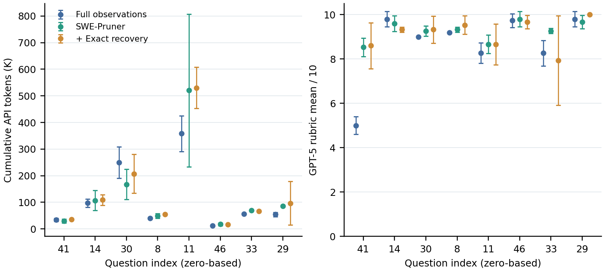
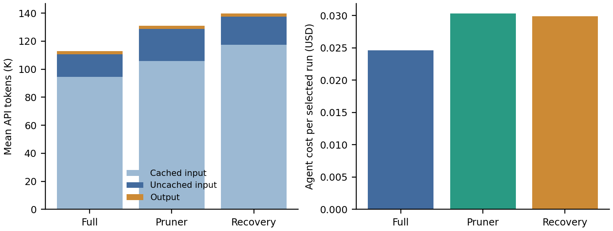

# SWE-Pruner 复现与精确观测恢复

Xia Feifan · 1155204948

FTEC5660 Individual Reproducibility Project · 2026 年 11 月 11 日

## 摘要

本项目使用作者的 OpenHands/SWE-QA 流程、发布权重和 GLM-4.6，在固定 Streamlink 八题上完成三条件、三次执行，共 72 项。完整观测、剪枝、剪枝加精确恢复的平均评分为 8.63、9.27、9.13，累计 tokens 为 112.8K、131.0K、139.8K。剪枝组相对完整观测增加 16.1% tokens，与论文减少 54.4% 的结果呈现不同方向；差异主要由剪枝触发频率、长输出和后续多轮调查解释。主要修改是任务级原始观测存储和有界行范围恢复。另一个 72 项固定上下文测试中，精确匹配从剪后观测的 3/24 提升到可恢复观测的 24/24，同时增加上下文开销。结果支持恢复证据的能力，并显示读取策略决定最终的质量与成本权衡。

## 1. 复现的目标是什么？

编程 Agent 会反复搜索、读取代码并根据工具输出决定下一步行动。一次读取返回的长文件会进入对话历史，随后多轮请求可能再次发送这些内容。SWE-Pruner 在工具输出进入 Agent 上下文之前，根据 Agent 提供的关注问题，用发布的 0.6B neural skimmer 保留相关代码片段 [1,2]。本项目选择课程清单第 26 项，运行作者的 OpenHands/SWE-QA 实现，验证其在 Streamlink 上的质量与 token 消耗权衡。

论文表 2 的 GLM-4.6 结果是本次复现的数值参照：

| 论文条件 | 平均评分 / 10 | 平均轮数 | 累计 tokens / 题 |
| --- | --- | --- | --- |
| GLM-4.6，完整观测 | 8.56 | 18.2 | 318,200 |
| GLM-4.6，SWE-Pruner | 8.56 | 25.0 | 145,100 |

论文中 tokens 减少 54.4%，平均评分保持 8.56，同时轮数增加。这个组合说明，评估需要同时考虑每轮上下文长度和总交互次数。本报告回答三个问题：本地是否出现相同的质量与资源权衡；差异主要出现在哪些题目和交互环节；加入原始观测的精确恢复功能后，回答质量、工具行为与资源消耗如何变化。

本次主实验使用相同的 GLM-4.6 模型标识、作者权重和评测流程，范围为预先选定的 8 道题，每题每条件执行 3 次。另设一个固定上下文实验，专门检验调查目标改变后能否取回被剪掉的证据。两类实验分别衡量自主任务表现和恢复机制的有效性。

<!-- page -->

## 2. 如何构造公平、可检查的比较？

### 2.1 数据、模型与共同设置

作者发布的 Streamlink 题库包含 48 道题。项目先以种子 5660 打乱题目索引，使用 43、26、17 做开发验证，保留原先选定的 41、14、30、8、11、46、33、29 做正式比较。索引均从 0 开始。样本覆盖 Cache 测试、Kaltura、CDP、OpenSSL 派生和 DASH 序列化，其中 4 题涉及 CDP。题目集合在改用 GLM 前已经确定，旧模型运行只作为开发记录保存。

| 控制项 | 本次配置与可比性 |
| --- | --- |
| 作者代码与仓库 | SWE-Pruner 96171b5；Streamlink ab1f365；题库 SHA-256 已记录 |
| Agent | OpenRouter z-ai/glm-4.6，固定 Z.AI，关闭 provider fallback |
| 生成设置 | temperature=0，top_p=1，输出容量 16,384 tokens |
| 剪枝与轮数 | 阈值 0.5、最多 250 轮，对齐论文附录 D.1 |
| 本地时间约束 | 每题 1,800 秒；本地剪枝服务等待 600 秒；超时另行记录 |
| 独立评分 | OpenAI GPT-5，作者原始五维 rubric；low reasoning effort，输出容量 4,096 |
| 执行环境 | WSL Ubuntu 22.04、Python 3.12、OpenHands SDK 1.1.0；Windows GPU 服务 |
| 文件访问 | 固定仓库快照以只读方式挂载到 /workspace；参考答案留在评分进程 |

模型路由日志揭示默认路由会跨供应商和量化格式切换，因此正式实验统一锁定 Z.AI；该端点公布 FP4 服务格式，论文未披露对应部署精度。相同模型名称缩小了模型差异，服务实现仍是解释边界 [3]。GPT-5 的模型名来自作者评分脚本注释，实际脚本通过环境变量选择部署；本次采用其原始 prompt，并明确记录 OpenRouter 上的评分配置。

### 2.2 运行顺序与失败处理

三组为完整输出、SWE-Pruner、SWE-Pruner＋精确恢复。作者工具通过可选的 `context_focus_question` 触发剪枝；参数为空时直接返回完整输出。本实验保留这一自主选择机制，并记录实际触发次数。所有题目和共同参数一致；每题内采用轮换顺序，三道题并行运行。三次执行观察服务端与 Agent 的运行差异，记录中没有额外指定供应商 seed。每个计划项都保留第一条轨迹；缺少答案、进程失败或剪枝服务失败时，最多追加一次明确标记的恢复尝试。评分高低不触发 Agent 补跑，评分服务的传输和格式错误单独重试。

<!-- page -->

## 3. 修改是什么，为什么值得测量？

### 3.1 从一次性剪枝到可恢复的观测

剪枝依据的是当前关注问题。随着调查推进，Agent 可能需要此前被判为无关的字段、边界条件或类型定义。若只保存剪后内容，这些细节需要重新读取；对于耗时、远程或难以重复执行的工具，保存原始观测提供了另一条取回证据的路径。

本项目的单一主要修改是 **task-scoped lossless observation recovery**。每次 Bash 输出保留捕获到的原始文本，并将作者的剪枝结果与观测 ID、总行数交给 Agent。Agent 可调用 `expand(observation_id, start, end)` 取回原始片段。范围采用观测文本中从 1 开始的闭区间，每次最多 200 行。重复读取、返回字符数及实际展开动作均有记录。

| 步骤 | 接口行为 | 可检查证据 |
| --- | --- | --- |
| 捕获 | 对原始工具文本生成内容 ID，存入任务级 store | ID 与原文 SHA-256 前缀一致 |
| 剪枝 | 使用作者权重、关注问题和阈值 0.5 | 服务响应和保留 token 数 |
| 通知 | 在工具结果后附加 ID 与观测行数 | 完整 Agent 对话轨迹 |
| 恢复 | 返回指定原始行，不再执行原工具 | 保存文本切片与返回结果一致 |
| 计量 | 记录范围、字符量和重复行 | observations.json 与请求 usage |

这里的“精确”指已捕获工具输出的字符序列。原 Bash 执行器会整理 stdout 首尾空白，因此恢复契约以捕获后的文本为边界；当输出包含 `cat -n` 的文件行号时，expand 参数仍然定位观测行。

### 3.2 预期收益与代价

预期收益是补回遗漏证据，并在适当情况下减少重新搜索。代价包括存储原文、在上下文中附加索引、额外工具回合和重复发送对话。主实验检验 Agent 是否自主使用这条路径，以及综合质量和成本变化；固定上下文实验直接检验证据丢失后的恢复能力。

运行前的端到端检查将一段 6,959-token 工具输出剪到 693 tokens，随后成功取回原始观测第 1–100 行，4,434 个字符逐字一致。这验证了工具链的恢复契约。任务收益由后续两组实验提供证据。

`observation_store.py` 只依赖 Python 标准库，OpenHands 绑定集中在 `recovery_tool.py`。这一接口可复用于 XJ13 的工具观测管理：保留原始观测、展示任务相关片段、按 ID 恢复范围，并记录实际读取量。当前 store 的生命周期为单个任务。

<!-- page -->

## 4. 主实验：复现效果如何？

全部 72 个计划项已完成并获得独立评分，每组 24 个。均值使用相同的八题、三次执行；SD 是三次整组均值的样本标准差。作者轮数按其 stats.py 计算所有 agent/user 来源事件，API 请求数另列。

| 条件 | 完整答案 | 评分均值 ± SD | tokens K ± SD | 作者轮数 | API 请求 |
| --- | --- | --- | --- | --- | --- |
| 完整观测 | 24/24 | 8.63 ± 0.10 | 112.8 ± 5.0 | 13.5 | 10.8 |
| SWE-Pruner | 24/24 | 9.27 ± 0.09 | 131.0 ± 30.6 | 15.1 | 9.8 |
| 剪枝＋精确恢复 | 24/24 | 9.13 ± 0.25 | 139.8 ± 23.4 | 14.4 | 11.6 |

相对完整观测，剪枝组累计 tokens 增加16.1%，平均评分变化 +0.63。加入恢复后，相对剪枝组 tokens 增加6.8%，评分变化 -0.13。

| 配对比较 | token 差 K [95% 区间] | 评分差 [95% 区间] |
| --- | --- | --- |
| 剪枝－完整 | +18.2 [-22.9, 66.7] | +0.63 [0.04, 1.52] |
| 恢复－剪枝 | +8.8 [1.8, 18.8] | -0.13 [-0.52, 0.13] |

区间以 8 道题为 cluster，保留每题内部三次执行，使用种子 5660 重采样 10,000 次。这一配对统计描述子集中的差异，图中的 SD 描述每题执行波动。

<!-- page -->

## 5. 为什么会得到这些结果？

本地剪枝组相对完整观测的 tokens 增加16.1%，论文报告降低 54.4%；本地评分差为 +0.63，论文为 0.00。作者过滤规则在两组共同且五维均不为 1 的题次上保留 24 对，过滤后完整／剪枝评分为 8.63/9.27。本地范围、评分部署和运行环境已明确记录，因此数值差异需要结合轨迹解释。

### 5.1 局部压缩与累计上下文

累计 API tokens 按 `C = sum_t (I_t + O_t)` 计算，输入包含缓存命中，输出包含服务商计入的 reasoning tokens。一次剪枝的保留率由 skimmer tokenizer 计量，它描述该次工具输出的压缩；最终 C 同时受到调用次数、后续上下文长度和生成量的影响。每次调用的 usage 和完整轨迹使这两个层次可以分别检查。

剪枝组在 10/24 个任务中实际调用 skimmer，共 16 次，将这些输出的 268,659 个源 tokens 保留为 63,009 个，压缩 76.5%。恢复组在 4/24 个任务中剪枝。自主选择使各组读代码的路径也发生变化。

按每题三次均值选择 token 降幅最大的 q30 和增幅最大的 q11。q30 的完整／剪枝均值为 249.8K／167.6K；第 1 次执行中，page.py 的 54,349 个源 tokens 被剪到 13,107，最大输入从 40,427 降到 18,258，API 调用为 11／10。长文件压缩在这一轨迹中转化为累计节省。

q11 的完整／剪枝均值为 358.2K／520.4K，三次剪枝组均未填写关注问题。第 3 次执行对整个 CDP 目录递归搜索 from_json 及事件解析，持续读取完整结果；最大输入达到 43,299，累计 826,860 tokens，完整组对应为 15,306 和 305,129。这个差异反映工具选择及调查路径。事后逐题影响检查中，移除 q11 后其余七题的 token 差为 −2.4K；主统计仍保留全部八题，95% 区间跨越增减两个方向。

评分提升集中于 q41：完整／剪枝均值为 5.00／8.53。题目要求定位 TestIO 的 test_load_data；完整组答案先讲 Cache 实现，再提测试，剪枝组直接定位测试方法。第 1 次完整答案得 4.6 分，虽包含正确的 dirty 机制，仍偏离了问题的定位重点。保留原始评分；事后移除 q41 后，评分差从 +0.63 变为 +0.22，说明单题与回答粒度对均值影响显著。

<!-- page -->

## 6. 修改带来了什么变化？

### 6.1 自主 Agent 中的使用与效果

恢复组在 4/24 个任务中成功展开，记录 21 次展开动作和 17 次成功读取，返回 62,921 个字符，其中重复行 8 行。对照上一次展示内容，16/17 次读取暴露了此前未展示的非空行。相对剪枝组，评分变化 -0.13、累计 tokens 增加6.8%。是否展开还受任务难度和 Agent 自选行为影响；下面通过固定上下文干预检查取回证据这一机制。

q29 的第 1 次执行展示了恢复的代价：Agent 用 8 次成功读取逐步展开整个 1,032 行生成脚本，产生 7 行重叠；另有 2 次请求因闭区间包含 201 行而被拒绝，随后自行修正。该次恢复组使用 189,803 tokens，完整组为 59,266，评分均为 10。当前接口把读取决策交给 Agent，这条轨迹说明它有时选择重建完整文件。q30 的部分展开则补回了剪后缺失的类定义；两类行为共同解释了恢复能力与总开销之间的权衡。

### 6.2 目标变化后的固定上下文检验

从固定仓库中筛选 25–180 行、含大写字符串常量的 plugin 文件，按文件名排序后以种子 5660 抽取 8 个。每个文件先针对“导入了哪些模块和类”进行剪枝，随后询问选定常量的精确字符串值。三组分别提供完整观测、剪后观测、剪后观测与相同恢复接口；每组每文件运行三次，以 JSON 字符串的精确匹配直接评分。病例选择在模型调用前完成，所有病例均保留。文件均可在一次 200 行上限内完整恢复，因此这一测试主要衡量证据可达性；长观测中的选段行为由主实验轨迹补充。

| 文件 | 目标值保留 | 完整 | 剪后 | 可恢复 |
| --- | --- | --- | --- | --- |
| nrk.py | 是 | 3/3 | 3/3 | 3/3 |
| vk.py | 否 | 3/3 | 0/3 | 3/3 |
| dailymotion.py | 否 | 3/3 | 0/3 | 3/3 |
| goodgame.py | 否 | 3/3 | 0/3 | 3/3 |
| sbscokr.py | 否 | 3/3 | 0/3 | 3/3 |
| zdf_mediathek.py | 否 | 3/3 | 0/3 | 3/3 |
| huajiao.py | 否 | 3/3 | 0/3 | 3/3 |
| cnbce.py | 否 | 3/3 | 0/3 | 3/3 |

完整观测为 24/24，剪后观测为 3/24，加入恢复后为 24/24。7 个文件的目标常量被剪掉，保留下来的 nrk.py 常量在三组中都被正确回答。恢复组自主完成了 29 次成功的范围读取，取回 28,315 个字符；它在这些固定病例中消除了缺少原始证据造成的错误。

收益伴随明确成本：完整、剪后、可恢复三组的累计 tokens 分别为 24,082、20,655、55,617，对应已报告费用 $0.019846、$0.022615、$0.035627。剪后组的输出计数为 6,585，超过完整组的 3,373；输出较贵，使总 tokens 更少的剪后组仍花费更多。恢复组的主要增长来自输入：52,482 对 20,709，额外回合使上下文被再次发送。这个实验支持在原始观测已离开当前上下文、后续目标改变时保留恢复能力；自主仓库 QA 还允许重新读取文件，因此综合收益应以主实验为依据。

<!-- page -->

## 7. 复现中解决了哪些实际问题？

| 观察到的问题 | 修复与验证 |
| --- | --- |
| 已完成却导出空答案 | SDK 的 FinishAction.name 可能为空；按动作类型识别最终消息，回归测试通过 |
| 长输入超过本机显存 | 对 SDPA 的 query 轴分块，保留全部 key/value 与 causal mask；验证数值和显存 |
| 大文件及并发请求等待过久 | 剪枝服务等待统一为 600 秒，每题仍保留 1,800 秒上限；服务失败单独标记 |
| API 自动切换部署 | 保留初期路由记录，正式组统一 Z.AI，评分统一 OpenAI，禁用 fallback |
| 评分传输返回非 JSON | 保存错误信息并执行有上限的传输重试；Agent 答案保持原记录 |
| 参考答案访问边界 | 所有 shell 命令在只读仓库 namespace 内执行；隔离测试检查宿主路径和密钥不可见 |

### 7.1 本地 GPU 适配的测量

硬件为 RTX 5060 Laptop，物理显存 8,151 MiB。复用已有 CUDA/PyTorch 环境和发布权重，未训练新模型。开发阶段的长输入触发原 60 秒剪枝服务等待超时，失败日志保留。query 分块将同一 attention 的工作矩阵限制在较小范围，各 query 仍关注完整 key/value 序列。

| 输入 tokens | 参考路径 | 参考／分块秒 | 参考／分块 GiB | 阈值决策差 |
| --- | --- | --- | --- | --- |
| 2813 | full_sdpa | 1.33/1.18 | 3.34/3.05 | 0 |
| 4096 | full_sdpa | 1.99/2.23 | 5.04/3.50 | 0 |
| 7044 | tiled512 | 5.94/6.50 | 4.57/4.54 | 0 |

这些固定检查中，0.5 阈值下的 token 决策均一致。7,044-token 检查比较 tile-256 与 tile-512；完整 SDPA 的超长比较因耗时被终止，相关开发记录保留。另一个针对 padding 的检查在第二个短样例上出现 1 个 token 的阈值翻转，说明有限精度差异仍需纳入复现边界。数值检查覆盖的是这些输入与配置。

主实验首轮三组分别导出 24/24/24 个完整答案，共保存 72 条正式尝试；最终所有 72 个计划项均完成评分。固定路由主实验与机制实验已报告 API 费用合计 $2.5666；包含旧阶段、开发记录和保守占用的项目账本为 $7.9262，用户批准上限为 $12。原始记录、启动快照和逐项审计均随材料保存。

主实验所有 Agent 首轮均成功。q29 完整组第 1 次执行的评分遇到一次 RemoteProtocolError，按统一策略重试后完成；原回答保持原样，未结算请求保留 $0.1161475 的保守占用。

<!-- page -->

## 8. 结论与适用边界

**复现效果。** 已运行作者工具链并验证长观测压缩行为。在本八题子集中，剪枝将实际处理的源文本压缩 76.5%，最终累计 tokens 增加 16.1%，评分提高 0.63。论文的整体节省幅度在本地样本中表现为不同的资源权衡，q11 的长调查轨迹对均值影响最大。

**修改效果。** 精确恢复在固定目标变化测试中把正确数从 3/24 提升到 24/24；自主 QA 中，相对剪枝组 tokens 增加 6.8%，平均评分变化 −0.13，评分差区间跨零。轨迹同时呈现补回缺失证据与重建整个文件两种行为。

**下一步。** 扩大题目覆盖，并在开发集上明确恢复预算、索引和停止策略，再冻结测试。XJ13 可沿用任务级存储接口，进一步比较结构化记录的投影与切片，测量证据覆盖、重复读取及总交互成本。

### 8.1 结果可以支持的范围

**样本与任务分布。** 主实验覆盖 48 道发布问题中的 8 道，CDP 题目占一半。长生成代码的比例会影响剪枝收益。三次执行和题目层面的 bootstrap 描述该子集的变化，推广到完整题库需要扩大样本。

**模型与评分。** 固定模型 ID 和 provider 控制了本次比较的部署变量；论文的精确 API 部署、量化和评分配置未完全披露。五维参考答案评分提供统一标准，仍会受到回答重点、参考答案粒度和 judge 行为影响。报告保留原始评分并核对具体案例。

**执行环境。** 本次使用只读代码快照、8GB GPU、共享本地剪枝服务及独立评分模型。上下文 token 的比较有逐请求 usage 支持；并行执行下的耗时受到服务排队和网络影响。目标变化测试限制证据来源为保存的观测，适用于分析恢复能力这一具体机制。

### 8.2 如何复查

`revision_glm/protocol.json` 给出实验设置；`run_study.py` 执行完整计划；`results/glm/` 保存逐项结果、配对统计、恢复轨迹分析和审计；`runs/glm/pinned/` 保存问题输入、答案、轨迹、原始 API 响应、usage 与启动源代码快照。`observation_store.py` 和 `recovery_tool.py` 是主要修改的实现。README 提供安装、运行与验证命令。

报告和代码整理使用 AI 协助；文中实验数值由保存的真实运行与分析脚本生成。演示脚本随材料提供，录屏和发布由学生完成。

### 参考资料

[1] SWE-Pruner: Self-Adaptive Context Pruning for Coding Agents. arXiv:2601.16746v1，表 2 与附录 D.1。[论文](https://arxiv.org/html/2601.16746v1)

[2] 作者实现与 SWE-QA 评分、统计脚本。固定 commit 96171b5f3ecaf89745cbeb436c8893b57f3400bd。[代码](https://github.com/Ayanami1314/swe-pruner/tree/96171b5f3ecaf89745cbeb436c8893b57f3400bd)

[3] OpenRouter Provider Routing，provider.only 与 allow_fallbacks 配置。[官方文档](https://openrouter.ai/docs/guides/routing/provider-selection)

[4] 发布的 code-pruner checkpoint，固定 revision 863cee3198c715c9df1faa422a3490e0832bb734。[模型](https://huggingface.co/ayanami-kitasan/code-pruner)
