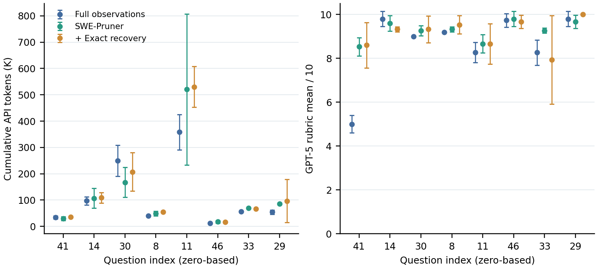
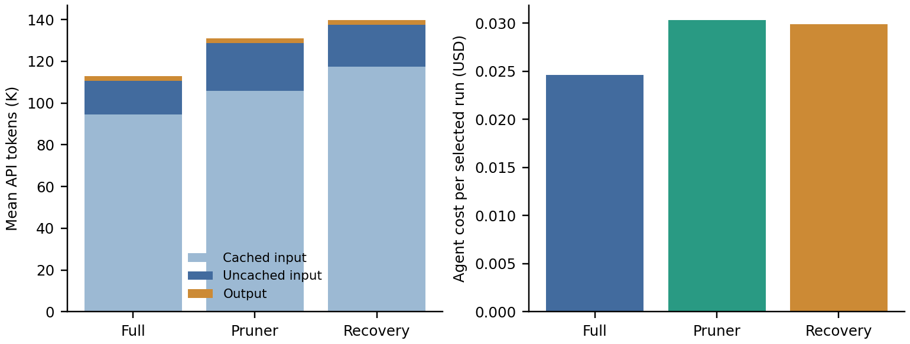

# SWE-Pruner: Reproduction and Exact Recovery

Xia Feifan · 1155204948

FTEC5660 Individual Reproducibility Project · 11 November 2026

## Abstract

{{ABSTRACT}}

## 1. Introduction

SWE-Pruner: Self-Adaptive Context Pruning for Coding Agents uses a 0.6B neural skimmer to select code lines relevant to an agent's current focus, reducing long tool outputs carried across turns [1,4]. We reproduce the authors' `downstream_eval/multi_turn/sweqa` implementation at commit 96171b5 [2]. OpenHands drives GLM-4.6 to search and read repositories through Bash; SWE-QA (Software Engineering Question Answering) supplies questions, reference answers and five-dimensional evaluation; SWE-Pruner filters Bash output before it enters context. These components define the execution framework, evaluation task and reproduced method.

The numerical target is the full-observation and SWE-Pruner rows for Streamlink with GLM-4.6 in the original Table 2. Both published scores are 8.56; tokens are 318.2K/145.1K and rounds 18.2/25.0. We use eight preselected questions from the 48-question release, three executions per condition, a fixed Z.AI GLM-4.6 route and independent GPT-5 scoring with the author rubric. Table 3 places published and local values together, identifying the subset scope.

The reproduced pipeline compresses processed source text by 76.5%, while mean task tokens rise from 112.8K to 131.0K (+16.1%) and score rises from 8.63 to 9.27. The local token point estimate therefore reverses the published −54.4% direction. Pruning activates in 10/24 tasks, and q11's long investigation strongly influences the aggregate; the paired token-difference interval spans zero. These observations bound the result by population, serving configuration and investigation behavior.

Our modification adds task-scoped original-observation storage and bounded exact line recovery. It raises goal-shift SR from 12.5% to 100% (+87.5 percentage points) at 169.3% higher cumulative token cost; autonomous QA scores decrease 1.4% with 6.8% more tokens. The `expand(observation_id, start, end)` interface returns up to 200 original lines per call. The mechanism study establishes evidence recovery, while autonomous outcomes motivate better range selection and stopping policies.

<!-- page -->

## 2. Method

### 2.1 Goal-conditioned pruning and exact recovery

Pruning responds to the current focus question. A later investigation step may require a field, boundary condition or type definition that was previously irrelevant. Retaining the captured original observation provides another way to retrieve such evidence, particularly when the original tool is slow, remote or difficult to repeat.

The primary modification is task-scoped lossless observation recovery. A store retains each captured Bash response. The agent receives the authors' pruned result plus an observation ID and line count, and can call `expand(observation_id, start, end)`. Ranges are inclusive, one-based and limited to 200 observation lines per call. Returned characters, repeated lines and expansion actions are logged.

Table 1. Exact-recovery interface and verification evidence.

| Step | Interface behavior | Evidence |
| --- | --- | --- |
| Capture | Store original text under a content ID | ID matches SHA-256 prefix |
| Prune | Released weights, focus question, threshold 0.5 | Raw service response and retained tokens |
| Expose handle | Append ID and observation line count | Complete conversation trace |
| Expand | Return original range without rerunning the tool | Exact stored-text slice |
| Account | Record range, characters and repeated lines | Store manifest and API usage |

Exactness is defined over the captured tool text. The original Bash executor strips outer stdout whitespace, so the contract starts after that capture step. File line numbers printed by `cat -n` and observation-range coordinates are separate.

### 2.2 Mechanism and resource implications

Recovery may repair missing evidence and reduce repeated searches. It also adds storage, an index in the prompt, a tool schema and potentially more model turns. The autonomous comparison measures uptake and the resulting quality/resource trade-off. The fixed-context experiment directly tests access to missing evidence after a goal change.

A pre-run integration check pruned a 6,959-token response to 693 tokens and recovered original observation lines 1–100, matching all 4,434 characters exactly. This establishes the interface contract; downstream experiments assess its task-level consequences.

The standard-library-only `observation_store.py` is separate from the OpenHands binding in `recovery_tool.py`. Structured-observation applications can reuse the same contract to retain raw observations, expose relevant views, recover ranges by ID and measure actual reads. The current store lifetime is one task.

<!-- page -->

## 3. Experimental setup

### 3.1 Data and common configuration

The released Streamlink file contains 48 questions. The project originally shuffled indices with seed 5660, reserving 43, 26 and 17 for development and selecting 41, 14, 30, 8, 11, 46, 33 and 29 for evaluation. All indices are zero-based. The sample covers Cache tests, Kaltura, CDP, OpenSSL derivation and DASH serialization; four questions concern CDP. The subset predates the GLM revision; earlier model runs remain development records.

Table 2. Shared reproduction settings and controlled scope.

| Control | Configuration and comparability |
| --- | --- |
| Source and data | SWE-Pruner 96171b5; Streamlink ab1f365; recorded question SHA-256 |
| Agent route | OpenRouter z-ai/glm-4.6; Z.AI only; provider fallback disabled |
| Decoding | Temperature 0; top_p 1; 16,384-token output capacity |
| Pruning and rounds | Threshold 0.5 and maximum 250 rounds, matching Appendix D.1 |
| Local time guards | 1,800 seconds/question; 600-second local pruning wait |
| Independent judge | OpenAI GPT-5; exact released five-dimension rubric; low reasoning effort; 4,096 output tokens |
| Environment | WSL Ubuntu 22.04, Python 3.12, OpenHands SDK 1.1.0; Windows GPU service |
| Evidence boundary | Clean repository mounted read-only at /workspace; references remain outside the agent shell |

Initial logs exposed automatic switching between providers with different advertised quantization formats. The definitive study fixes Z.AI, whose endpoint advertises FP4; the paper does not identify its corresponding deployment precision. Matching the model identifier reduces one source of variation while leaving serving implementation as a limitation [3]. The authors' judge comments name GPT-5, whereas executable code selects a deployment through environment variables. This study preserves the exact prompt and records the OpenRouter judge adaptation.

### 3.2 Schedule and failure policy

The three conditions are full observations, SWE-Pruner, and SWE-Pruner with exact recovery. The authors' optional `context_focus_question` triggers pruning; an empty value returns full output. We preserve this autonomous choice and measure actual activation. Questions and shared parameters are identical. Condition order rotates within each question/repetition; three question blocks run concurrently. Three executions measure run-to-run variation; provider seeds are unspecified. First attempts are retained. Missing answers, process failures and pruning-service failures permit one identified recovery attempt. Judge scores never trigger agent reruns; judge transport/schema failures have separate bounded retries.

### 3.3 Metrics and statistical analysis

Cumulative usage is `C = sum_t (I_t + O_t)`, including cached input and provider-accounted reasoning within output. The skimmer's retained-token fraction measures compression of a particular tool response using its own tokenizer. Total C also depends on request count, subsequent prompt lengths and generation volume. Request-level usage and trajectories separate these layers.

<!-- page -->

## 4. Results and analysis

### 4.1 Published and reproduced results

{{MAIN_RESULTS}}

{{PAPER_COMPARISON}}

{{UNCERTAINTY}}

<!-- page -->

### 4.2 Cumulative resource use and question-level variation

{{CASE_ANALYSIS}}

{{JUDGE_ANALYSIS}}

<!-- page -->

### 4.3 Recovery outcomes and mechanism

{{AUTONOMOUS_RECOVERY}}

In q29 repetition 1, the agent reconstructs the entire 1,032-line generator through eight successful reads, with seven overlapping lines. Two 201-line inclusive ranges are rejected and then corrected. Recovery uses 189,803 tokens versus 59,266 for full observations; both score 10. The interface delegates reading decisions to the agent, which can choose full reconstruction. In q30, selected expansions instead expose missing class definitions. These traces illustrate both evidence recovery and the cost of the chosen retrieval policy.

Eligible pinned plugin files contain 25–180 lines and an uppercase string constant. After sorting filenames, seed 5660 selects eight files. Each observation is pruned for an import-inspection goal; a follow-up asks for the exact selected constant. Full, pruned and recoverable observations are compared over three executions, scored by exact JSON-string equality; SR is the percentage of planned runs that match. Selection precedes model calls, and every selected case remains in the analysis. Each file fits within one 200-line expansion, so this test primarily measures evidence accessibility; the main-study traces additionally show range selection in long observations.

{{MECHANISM_TABLE}}

SR is 100% (24/24) for full observations, 12.5% (3/24) after pruning, and 100% (24/24) with recovery. Seven targets were removed; the surviving nrk.py target is answered correctly in all conditions. The recovery condition makes 29 successful range reads, retrieving 28,315 characters and repairing missing-evidence errors in these fixed cases.

Relative to pruning, recovery increases tokens 169.3% and API fees 57.5%. Tokens total 24,082 / 20,655 / 55,617 for full / pruned / recoverable observations, costing $0.019846 / $0.022615 / $0.035627. Pruned-only output rises to 6,585 tokens versus 3,373 for full observations; more expensive output makes the smaller-token condition costlier. Recovery mainly increases input: 52,482 versus 20,709, reflecting additional turns and retransmitted context. This supports preserving evidence for later goals. Repository agents can also reread files, so autonomous net utility is assessed separately.

<!-- page -->

## 5. Discussion and limitations

The main weaknesses are population coverage and causal attribution. Eight questions cover 16.7% of the release; half concern CDP, and q11 strongly influences the aggregate. A post-hoc omission leaves only 3.1% savings. Optional focus-triggered pruning follows paper §3.2 and the release [1,2]. Six tool/interface ASTs match the author implementation; frozen configuration and usage audits pass. Evidence establishes local compression and recovery, while a robust end-to-end estimate requires full-population evaluation and a separately labelled fixed-trajectory or trigger-policy ablation.

Model/provider pins control deployment variation within this comparison. The paper's exact deployment, quantization and judge configuration are incompletely specified. Reference-based rubric scores also depend on answer focus, reference granularity and judge behavior. Raw scores are retained alongside code-grounded case inspection.

The study uses a read-only snapshot, an 8GB GPU and a shared local pruning service. Token comparisons are backed by per-request usage; concurrent wall times include queueing and network effects. The goal-shift test deliberately limits evidence to a saved observation and supports a mechanism-specific conclusion.

## 6. Conclusion

{{CONCLUSIONS}}

### References

[1] SWE-Pruner: Self-Adaptive Context Pruning for Coding Agents. arXiv:2601.16746v1, Table 2 and Appendix D.1. [Paper](https://arxiv.org/html/2601.16746v1)

[2] Released implementation and SWE-QA scoring/statistics scripts, commit 96171b5f3ecaf89745cbeb436c8893b57f3400bd. [Repository](https://github.com/Ayanami1314/swe-pruner/tree/96171b5f3ecaf89745cbeb436c8893b57f3400bd)

[3] OpenRouter Provider Routing: provider.only and allow_fallbacks. [Documentation](https://openrouter.ai/docs/guides/routing/provider-selection)

[4] Released code-pruner checkpoint, revision 863cee3198c715c9df1faa422a3490e0832bb734. [Model](https://huggingface.co/ayanami-kitasan/code-pruner)

<!-- page -->

## Appendix A. Implementation and reproducibility

Table A1. Runtime adaptations and validation.

| Observed problem | Repair and verification |
| --- | --- |
| Completed task exported an empty answer | Recognize FinishAction by type when name is null; regression test passes |
| Long inputs exceeded local GPU memory | Tile SDPA queries while retaining all keys/values and causal masks; numerical and memory checks |
| Large files/concurrent pruning exceeded the wait | Uniform 600-second local wait; retain 1,800-second question guard and explicit failure records |
| API silently switched deployments | Retain route audit; pin Z.AI agents and OpenAI judges; disable provider fallback |
| Judge transport returned non-JSON data | Preserve errors and retry within a bound; retain the same agent answer |
| Reference-answer access boundary | Read-only repository namespace; tests verify host-path and key exclusion |

### A.1 Local GPU numerical and resource validation

An RTX 5060 Laptop (8,151 MiB) runs the released weights in an existing CUDA/PyTorch environment. Query tiling limits the attention work matrix while preserving complete keys/values. Long development inputs exceeded the original 60-second service wait; the retained logs motivate the common 600-second setting.

Table A2. Numerical and resource validation of query tiling.

{{NUMERICAL_TABLE}}

Threshold-0.5 decisions agree on these checks. The 7,044-token case compares tiles 256/512; a slower full-SDPA comparison was stopped. A separate padding probe changes one token decision. The retained evidence characterizes tested feasibility and finite-precision sensitivity.

{{COMPLETENESS_AND_COST}}

All agent first attempts succeeded. A q29/full judge request required one RemoteProtocolError retry with the unchanged answer; its unsettled charge retains a $0.1161475 reservation.

### A.2 Artifacts and evidence index

`revision_glm/protocol.json` and `run_study.py` define and execute the design. `results/glm/` contains analysis and audit; `runs/glm/pinned/` retains inputs, answers, trajectories, API responses, usage and launch-source snapshots. README documents installation and verification of the recovery implementation.

AI assisted implementation and writing. Saved executions and deterministic analysis supply all experimental values. The artifact includes a demonstration script.
