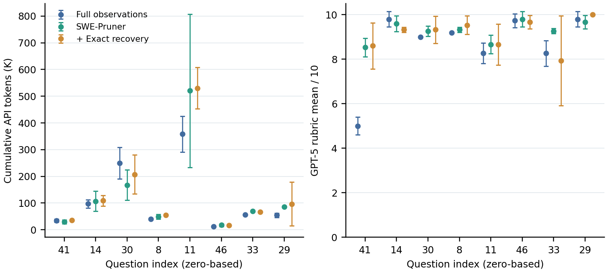
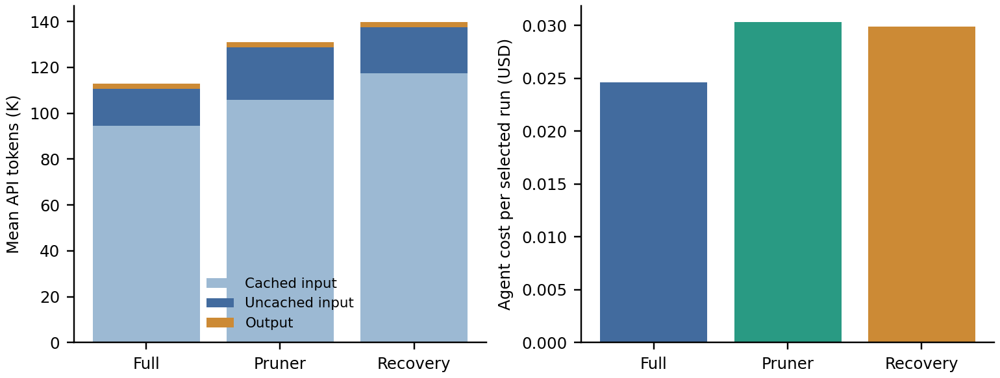

# SWE-Pruner 复现与精确观测恢复

Xia Feifan · 1155204948

FTEC5660 Individual Reproducibility Project · 2026 年 11 月 11 日

## 摘要

{{ABSTRACT}}

## 1. 引言

编程 Agent 会反复搜索、读取代码并根据工具输出决定下一步行动。一次读取返回的长文件会进入对话历史，随后多轮请求可能再次发送这些内容。SWE-Pruner 在工具输出进入 Agent 上下文之前，根据 Agent 提供的关注问题，用发布的 0.6B neural skimmer 保留相关代码片段 [1,2]。本项目选择课程清单第 26 项，运行作者的 OpenHands/SWE-QA 实现，验证其在 Streamlink 上的质量与 token 消耗权衡。

论文表 2 在 Streamlink 上报告：GLM-4.6 配合 SWE-Pruner 保持平均评分，同时减少累计 tokens [1]。这一结果涉及局部观测压缩和完整调查过程两个层面：单次工具输出缩短后，Agent 的读取选择、交互轮数与后续上下文仍可能改变最终资源消耗。本文以相同模型标识、发布权重和作者评测流程，考察该质量与资源权衡在固定问题子集上的表现，并将原文与复现数值统一列于表 3。

本文进一步研究剪枝后证据的可恢复性。当前关注问题可能随调查推进而改变，原始观测中的被删片段因而可能重新变得相关。为此，本文在作者剪枝流程上增加任务级原始观测存储及有界行范围恢复，并分别测量自主仓库问答中的综合效果与固定目标变化条件下的证据访问能力。

本次主实验使用相同的 GLM-4.6 模型标识、作者权重和评测流程，范围为预先选定的 8 道题，每题每条件执行 3 次。另设一个固定上下文实验，专门检验调查目标改变后能否取回被剪掉的证据。两类实验分别衡量自主任务表现和恢复机制的有效性。

本文的工作包括：复现 GLM-4.6 条件下的三组完整对照，结合逐请求计量解释与原文的差异；实现可复用的精确观测恢复接口；通过自主任务与固定上下文实验刻画恢复能力的收益和代价。

<!-- page -->

## 2. 方法

### 2.1 任务相关剪枝与精确恢复

剪枝依据的是当前关注问题。随着调查推进，Agent 可能需要此前被判为无关的字段、边界条件或类型定义。若只保存剪后内容，这些细节需要重新读取；对于耗时、远程或难以重复执行的工具，保存原始观测提供了另一条取回证据的路径。

本项目的单一主要修改是 task-scoped lossless observation recovery。每次 Bash 输出保留捕获到的原始文本，并将作者的剪枝结果与观测 ID、总行数交给 Agent。Agent 可调用 `expand(observation_id, start, end)` 取回原始片段。范围采用观测文本中从 1 开始的闭区间，每次最多 200 行。重复读取、返回字符数及实际展开动作均有记录。

表 1. 精确观测恢复接口及其验证依据。

| 步骤 | 接口行为 | 可检查证据 |
| --- | --- | --- |
| 捕获 | 对原始工具文本生成内容 ID，存入任务级 store | ID 与原文 SHA-256 前缀一致 |
| 剪枝 | 使用作者权重、关注问题和阈值 0.5 | 服务响应和保留 token 数 |
| 通知 | 在工具结果后附加 ID 与观测行数 | 完整 Agent 对话轨迹 |
| 恢复 | 返回指定原始行，不再执行原工具 | 保存文本切片与返回结果一致 |
| 计量 | 记录范围、字符量和重复行 | observations.json 与请求 usage |

这里的“精确”指已捕获工具输出的字符序列。原 Bash 执行器会整理 stdout 首尾空白，因此恢复契约以捕获后的文本为边界；当输出包含 `cat -n` 的文件行号时，expand 参数仍然定位观测行。

### 2.2 作用机制与资源开销

预期收益是补回遗漏证据，并在适当情况下减少重新搜索。代价包括存储原文、在上下文中附加索引、额外工具回合和重复发送对话。主实验检验 Agent 是否自主使用这条路径，以及综合质量和成本变化；固定上下文实验直接检验证据丢失后的恢复能力。

运行前的端到端检查将一段 6,959-token 工具输出剪到 693 tokens，随后成功取回原始观测第 1–100 行，4,434 个字符逐字一致。这验证了工具链的恢复契约。任务收益由后续两组实验提供证据。

`observation_store.py` 只依赖 Python 标准库，OpenHands 绑定集中在 `recovery_tool.py`。这一接口支持结构化工具观测管理的后续扩展：保留原始观测、展示任务相关片段、按 ID 恢复范围，并记录实际读取量。当前 store 的生命周期为单个任务。

<!-- page -->

## 3. 实验设置

### 3.1 数据、模型与共同设置

作者发布的 Streamlink 题库包含 48 道题。项目先以种子 5660 打乱题目索引，使用 43、26、17 做开发验证，保留原先选定的 41、14、30、8、11、46、33、29 做正式比较。索引均从 0 开始。样本覆盖 Cache 测试、Kaltura、CDP、OpenSSL 派生和 DASH 序列化，其中 4 题涉及 CDP。题目集合在改用 GLM 前已经确定，旧模型运行只作为开发记录保存。

表 2. 复现实验的共同配置与控制范围。

| 控制项 | 本次配置与可比性 |
| --- | --- |
| 作者代码与仓库 | SWE-Pruner 96171b5；Streamlink ab1f365；题库 SHA-256 已记录 |
| Agent | OpenRouter z-ai/glm-4.6，固定 Z.AI，关闭 provider fallback |
| 生成设置 | temperature=0，top_p=1，输出容量 16,384 tokens |
| 剪枝与轮数 | 阈值 0.5、最多 250 轮，对齐论文附录 D.1 |
| 本地时间约束 | 每题 1,800 秒；本地剪枝服务等待 600 秒；超时另行记录 |
| 独立评分 | OpenAI GPT-5，作者原始五维 rubric；low reasoning effort，输出容量 4,096 |
| 执行环境 | WSL Ubuntu 22.04、Python 3.12、OpenHands SDK 1.1.0；Windows GPU 服务 |
| 文件访问 | 固定仓库快照以只读方式挂载到 /workspace；参考答案留在评分进程 |

模型路由日志揭示默认路由会跨供应商和量化格式切换，因此正式实验统一锁定 Z.AI；该端点公布 FP4 服务格式，论文未披露对应部署精度。相同模型名称缩小了模型差异，服务实现仍是解释边界 [3]。GPT-5 的模型名来自作者评分脚本注释，实际脚本通过环境变量选择部署；本次采用其原始 prompt，并明确记录 OpenRouter 上的评分配置。

### 3.2 运行顺序与失败处理

三组为完整输出、SWE-Pruner、SWE-Pruner＋精确恢复。作者工具通过可选的 `context_focus_question` 触发剪枝；参数为空时直接返回完整输出。本实验保留这一自主选择机制，并记录实际触发次数。所有题目和共同参数一致；每题内采用轮换顺序，三道题并行运行。三次执行观察服务端与 Agent 的运行差异，记录中没有额外指定供应商 seed。每个计划项都保留第一条轨迹；缺少答案、进程失败或剪枝服务失败时，最多追加一次明确标记的恢复尝试。评分高低不触发 Agent 补跑，评分服务的传输和格式错误单独重试。

### 3.3 评价指标与统计方法

累计 API tokens 按 `C = sum_t (I_t + O_t)` 计算，输入包含缓存命中，输出包含服务商计入的 reasoning tokens。一次剪枝的保留率由 skimmer tokenizer 计量，它描述该次工具输出的压缩；最终 C 同时受到调用次数、后续上下文长度和生成量的影响。每次调用的 usage 和完整轨迹使这两个层次可以分别检查。

<!-- page -->

## 4. 实验结果与分析

### 4.1 原论文与复现结果对照

{{MAIN_RESULTS}}

{{PAPER_COMPARISON}}

{{UNCERTAINTY}}

<!-- page -->

### 4.2 累计资源消耗与逐题差异

{{CASE_ANALYSIS}}

{{JUDGE_ANALYSIS}}

<!-- page -->

### 4.3 精确恢复的效果与机制

{{AUTONOMOUS_RECOVERY}}

q29 的第 1 次执行展示了恢复的代价：Agent 用 8 次成功读取逐步展开整个 1,032 行生成脚本，产生 7 行重叠；另有 2 次请求因闭区间包含 201 行而被拒绝，随后自行修正。该次恢复组使用 189,803 tokens，完整组为 59,266，评分均为 10。当前接口把读取决策交给 Agent，这条轨迹说明它有时选择重建完整文件。q30 的部分展开则补回了剪后缺失的类定义；两类行为共同解释了恢复能力与总开销之间的权衡。

从固定仓库中筛选 25–180 行、含大写字符串常量的 plugin 文件，按文件名排序后以种子 5660 抽取 8 个。每个文件先针对“导入了哪些模块和类”进行剪枝，随后询问选定常量的精确字符串值。三组分别提供完整观测、剪后观测、剪后观测与相同恢复接口；每组每文件运行三次，以 JSON 字符串的精确匹配直接评分。病例选择在模型调用前完成，所有病例均保留。文件均可在一次 200 行上限内完整恢复，因此这一测试主要衡量证据可达性；长观测中的选段行为由主实验轨迹补充。

{{MECHANISM_TABLE}}

完整观测为 24/24，剪后观测为 3/24，加入恢复后为 24/24。7 个文件的目标常量被剪掉，保留下来的 nrk.py 常量在三组中都被正确回答。恢复组自主完成了 29 次成功的范围读取，取回 28,315 个字符；它在这些固定病例中消除了缺少原始证据造成的错误。

收益伴随明确成本：完整、剪后、可恢复三组的累计 tokens 分别为 24,082、20,655、55,617，对应已报告费用 $0.019846、$0.022615、$0.035627。剪后组的输出计数为 6,585，超过完整组的 3,373；输出较贵，使总 tokens 更少的剪后组仍花费更多。恢复组的主要增长来自输入：52,482 对 20,709，额外回合使上下文被再次发送。这个实验支持在原始观测已离开当前上下文、后续目标改变时保留恢复能力；自主仓库 QA 还允许重新读取文件，因此综合收益应以主实验为依据。

<!-- page -->

## 5. 讨论与局限

主实验覆盖 48 道发布问题中的 8 道，CDP 题目占一半。长生成代码的比例会影响剪枝收益。三次执行和题目层面的 bootstrap 描述该子集的变化，推广到完整题库需要扩大样本。

固定模型 ID 和 provider 控制了本次比较的部署变量；论文的精确 API 部署、量化和评分配置未完全披露。五维参考答案评分提供统一标准，仍会受到回答重点、参考答案粒度和 judge 行为影响。报告保留原始评分并核对具体案例。

本次使用只读代码快照、8GB GPU、共享本地剪枝服务及独立评分模型。上下文 token 的比较有逐请求 usage 支持；并行执行下的耗时受到服务排队和网络影响。目标变化测试限制证据来源为保存的观测，适用于分析恢复能力这一具体机制。

## 6. 结论

{{CONCLUSIONS}}

### 参考资料

[1] SWE-Pruner: Self-Adaptive Context Pruning for Coding Agents. arXiv:2601.16746v1，表 2 与附录 D.1。[论文](https://arxiv.org/html/2601.16746v1)

[2] 作者实现与 SWE-QA 评分、统计脚本。固定 commit 96171b5f3ecaf89745cbeb436c8893b57f3400bd。[代码](https://github.com/Ayanami1314/swe-pruner/tree/96171b5f3ecaf89745cbeb436c8893b57f3400bd)

[3] OpenRouter Provider Routing，provider.only 与 allow_fallbacks 配置。[官方文档](https://openrouter.ai/docs/guides/routing/provider-selection)

[4] 发布的 code-pruner checkpoint，固定 revision 863cee3198c715c9df1faa422a3490e0832bb734。[模型](https://huggingface.co/ayanami-kitasan/code-pruner)

<!-- page -->

## 附录 A. 实现适配与可复查性

表 A1. 运行适配与验证记录。

| 观察到的问题 | 修复与验证 |
| --- | --- |
| 已完成却导出空答案 | SDK 的 FinishAction.name 可能为空；按动作类型识别最终消息，回归测试通过 |
| 长输入超过本机显存 | 对 SDPA 的 query 轴分块，保留全部 key/value 与 causal mask；验证数值和显存 |
| 大文件及并发请求等待过久 | 剪枝服务等待统一为 600 秒，每题仍保留 1,800 秒上限；服务失败单独标记 |
| API 自动切换部署 | 保留初期路由记录，正式组统一 Z.AI，评分统一 OpenAI，禁用 fallback |
| 评分传输返回非 JSON | 保存错误信息并执行有上限的传输重试；Agent 答案保持原记录 |
| 参考答案访问边界 | 所有 shell 命令在只读仓库 namespace 内执行；隔离测试检查宿主路径和密钥不可见 |

### A.1 本地 GPU 数值与资源验证

硬件为 RTX 5060 Laptop，物理显存 8,151 MiB。复用已有 CUDA/PyTorch 环境和发布权重，未训练新模型。开发阶段的长输入触发原 60 秒剪枝服务等待超时，失败日志保留。query 分块将同一 attention 的工作矩阵限制在较小范围，各 query 仍关注完整 key/value 序列。

表 A2. Query 分块的数值与资源验证。

{{NUMERICAL_TABLE}}

这些固定检查中，0.5 阈值下的 token 决策均一致。7,044-token 检查比较 tile-256 与 tile-512；完整 SDPA 的超长比较因耗时被终止，相关开发记录保留。另一个针对 padding 的检查在第二个短样例上出现 1 个 token 的阈值翻转，说明有限精度差异仍需纳入复现边界。数值检查覆盖的是这些输入与配置。

{{COMPLETENESS_AND_COST}}

主实验所有 Agent 首轮均成功。q29 完整组第 1 次执行的评分遇到一次 RemoteProtocolError，按统一策略重试后完成；原回答保持原样，未结算请求保留 $0.1161475 的保守占用。

### A.2 复现材料与证据索引

`revision_glm/protocol.json` 给出实验设置；`run_study.py` 执行完整计划；`results/glm/` 保存逐项结果、配对统计、恢复轨迹分析和审计；`runs/glm/pinned/` 保存问题输入、答案、轨迹、原始 API 响应、usage 与启动源代码快照。`observation_store.py` 和 `recovery_tool.py` 是主要修改的实现。README 提供安装、运行与验证命令。

报告和代码整理使用 AI 协助；文中实验数值由保存的真实运行与分析脚本生成。演示脚本随材料提供，录屏和发布由学生完成。
