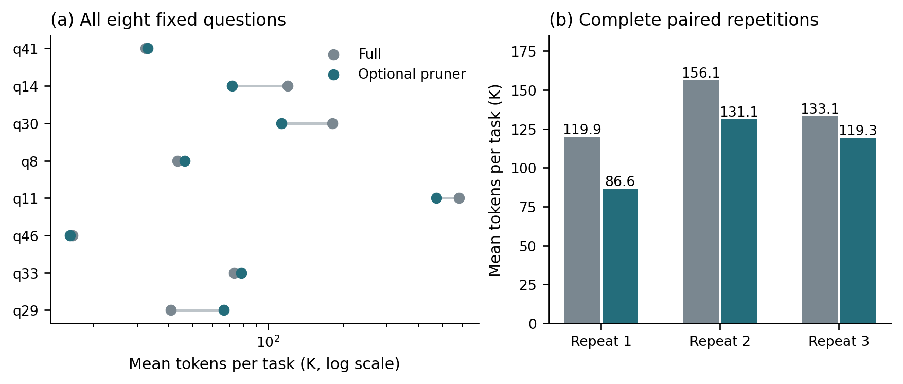
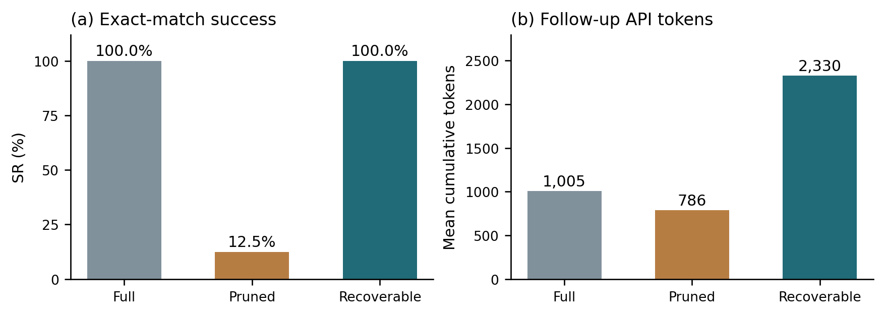

# SWE-Pruner 复现与有界原始观测恢复

Xia Feifan · 1155204948

FTEC5660 Individual Reproducibility Project · 2026 年 11 月

固定 subset 验证稿 · 小范围对齐诊断

## 摘要

本文复现 SWE-Pruner 在 OpenHands 执行框架和 SWE-QA 仓库问答任务中的表现，目标为原论文表 2 的 Streamlink × GLM-4.6 full/SWE-Pruner 对照。实验使用发布的代码、权重、问题与参考答案，并核对作者公开运行轨迹中的执行目录、步数、提示词和推理配置。作者公开运行记录暴露了论文 GLM token 数值的仓库对应差异：Streamlink 的累计 tokens 复算为 142.3K → 101.2K（−28.9%），论文该行写为 318.2K → 145.1K（−54.4%）。固定八题、每组重复三次的 48 项问答全部完成。修复执行目录、步数、padding 与参数加载精度后，原始可选提示协议的累计 tokens 降低 17.6%，评分提高 1.3%；三个重复的 token 方向一致，问题 cluster 区间跨零，剪枝触发覆盖率为 25.0%。作者同一八题的累计 tokens 下降 49.9%。全部 131 条作者观测重放得到 96.9% 逐字匹配，压缩率为本地 81.12%、作者 81.11%；剩余差距集中于 hint 使用与搜索路径。 本文新增任务级原始观测存储与有界行范围恢复。在原协议下，该修改使平均评分提高 1.4%、累计 tokens 增加 11.3%；质量变化区间跨零。固定证据目标变化实验的精确匹配 SR 从 12.5% 提升至 100.0%，累计 tokens 增加 196.4%。 结果分析同时覆盖答案质量、累计 tokens、剪枝触发、基础设施失败和实际恢复行为，以说明端到端收益成立的条件。

## 1. 引言

编程 Agent 通过搜索、读取和检查仓库逐步形成答案。一次读取的大段代码会随对话历史反复发送给模型，调查路径越长，早期观测的累积成本越高。SWE-Pruner 根据 Agent 当前关注的问题，用 0.6B neural skimmer 选择相关代码行，再把选出的文本交回 Agent [1]。本项目检验这一机制能否在可用部署中保持答案质量并降低整项任务的 token 消耗。

本文的代码对象是作者仓库 `downstream_eval/multi_turn/sweqa`，固定 commit 为 96171b5 [2]。OpenHands 负责模型调用与 Bash 工具执行，SWE-QA 提供仓库问题、参考答案和五维评分，SWE-Pruner 作用于 Bash 输出进入上下文之前。原论文还评价了 SWE-Bench Verified 与单轮代码任务；本项目的数值目标限定于表 2 的 Streamlink 和 GLM-4.6 两行。这一范围使模型、仓库、工具链和评价流程均有明确的核对对象。

复现的主要难点是连接局部压缩与完整任务表现。删除一次工具输出中的大量文本，可能减少后续输入，也可能引发额外搜索、读取或答案遗漏。因此本文分别测量剪枝文本的保留率、整项任务累计 API tokens，以及参考答案评分，并追踪 Agent 何时真正触发剪枝。修正后原协议得到 136.4K → 112.3K tokens（−17.6%）和 9.00 → 9.12 评分（+1.3%）。相比旧配置的 +16.1% tokens，端到端方向恢复为下降；平均降幅与作者相同八题记录的 −49.9% 仍有差距，低触发覆盖率也限制了对剪枝机制的归因。同一输入下的剪枝器压缩率已高度一致；本地 Bash hint 使用率为 2.4%，作者为 100%，作者 full 还包含九次命令超时。

剪枝还会造成后续证据访问问题：Agent 的关注点改变后，先前删除的某段细节可能重新变得重要。本文保留每次工具输出的完整捕获文本，并提供 `expand(observation_id, start, end)`，每次恢复最多 200 行。原协议八题三重复结果显示，该修改相对 SWE-Pruner 提高平均评分 1.4%，代价为 11.3% 更多 tokens。12 次成功恢复均返回此前未显示的原始文本，恢复覆盖 12.5% 的任务。受控目标变化实验的 SR 提升 87.5 个百分点，伴随 196.4% 更多 tokens；这些结果把精确取回的能力与完整 Agent 的成本权衡连接起来。 这一修改的作用范围是观测存储与精确取回；模型、skimmer 权重、阈值和评分流程保持共同配置。

本文的结果由三类证据支撑：作者公开运行记录与本地配置审计、完整的配对自主问答实验，以及固定输入的数值重放和证据恢复实验。下面先给出被复现的方法与修改接口，再说明配置修复、统一结果表和轨迹层面的解释。

## 2. 方法与复现对象

### 2.1 SWE-Pruner 工具输出剪枝

一次交互中，Agent 生成 Bash 命令和可选的 `context_focus_question`。存在非空 hint 时，执行器把捕获输出与 hint 交给本地 skimmer；缺省时直接返回完整输出。发布的工具说明允许为短而重要的输出省略 hint，并建议使用带行号的完整读取，再通过 `sed` 查看局部细节。因此，实际触发率属于运行行为，需要从轨迹中统计。

skimmer 对输入进行最多 8192 位置的分块处理，重叠区域的 token 分数合并后映射到字符，再对每行有覆盖的字符分数求平均。行分数达到阈值 0.5 时保留；发布代码还保留两个保留行之间的单行缺口，并在删除位置插入行数标记 [2,3]。本地使用发布权重，全部实验保持阈值和文本处理逻辑一致。

累计 API tokens 定义为 C = Σₜ(Iₜ + Oₜ)，其中输入 I 包含缓存命中的 tokens，输出 O 包含服务商计入的 reasoning tokens。固定观测的压缩率定义为 1 − Σ kept / Σ raw，使用 skimmer tokenizer。前者反映实际对话路径、重复历史和生成量；后者反映 skimmer 对已触发观测的选择行为。二者使用各自明确的分母。

### 2.2 任务级原始观测存储与恢复

修改在原始工具输出捕获后保存文本，以内容哈希生成观测 ID，并向 Agent 提供 ID 与原始行数。Agent 调用 expand 时，存储模块按照从 1 开始的闭区间返回原始文本切片。每次最多 200 行，未知 ID、越界或超长范围返回明确错误。记录包含请求范围、返回字符数和重复读取行数，支持分析恢复是否补充新证据。

保存边界为 Bash 执行器捕获并整理 stdout 后的文本。带行号的命令输出可能包含源文件行号，expand 参数始终指向保存观测中的行位置。每个任务由独立进程执行，存储生命周期因此限定为单个任务。底层 `observation_store.py` 仅使用 Python 标准库，OpenHands 绑定集中在 `recovery_tool.py`，便于在 XJ13 中独立复用。

恢复的预期收益是精确取回已捕获证据，成本则来自索引提示、额外工具回合和取回文本随对话历史重复发送。自主问答实验检验这一完整权衡；固定观测的目标变化实验检验遗漏证据能否被找回。两类实验分别报告，避免把受控的证据访问收益直接推广到具有 Bash 重读能力的完整 Agent。

### 2.3 剪枝触发策略诊断

作者记录的 996 次 Streamlink pruner Bash 调用全部具有非空 hint。本地配置修复后的三轮实验中，6/24 个 pruner 任务触发剪枝，覆盖率为 25.0%。三道独立开发题上，默认、开启和关闭 reasoning 的九次首轮探针均省略 hint；Novita/BF16 的三次探针也全部省略。所有探针均使用同一初始提示与工具定义，尚未执行 shell 命令。

为隔离触发策略，另设必填 hint 诊断组：仅把该 action 字段约束为必填非空字符串，其他执行和评分配置保持共同设置。配套完整输出组沿用完全相同的必填 schema，执行器返回全部捕获文本；剪枝组实际调用 skimmer。两组各完成固定八题一次，用于观察文本过滤的作用。schema 检查验证缺省、空字符串和 null 被拒绝，合法问题被接受；AST 对照确认其余执行逻辑一致。恢复模块分别在原始可选提示协议与这一强制触发诊断中测量，完整保留两个场景的分母与解释范围。

## 3. 配置与作者公开运行记录审计

### 3.1 原论文数值与发布文件对应

作者 README 提供的公开 ZIP 包含问题答案、评分、轨迹和运行配置。我们逐条匹配问题身份并复算 input+output，发现 Streamlink 与 Reflex 的 GLM token 值交叉对应论文表 2；各自的评分和轮数对应关系保持一致。两个仓库的 48 道问题分别精确匹配同名题库，跨仓库交集为零。表 1 同时保留论文和发布文件，定位这一来源差异。

| 仓库与来源 | full tokens K | pruner tokens K | 变化 | full/pruner 评分 |
|---|---|---|---|---|
| Streamlink，论文表 2 | 318.2 | 145.1 | −54.4% | 8.56 / 8.56 |
| Streamlink，作者公开运行记录 | 142.3 | 101.2 | −28.9% | 8.56 / 8.56 |
| Reflex，论文表 2 | 142.3 | 101.2 | −28.9% | 8.37 / 8.23 |
| Reflex，作者公开运行记录 | 318.2 | 145.1 | −54.4% | 8.37 / 8.23 |

表 1. GLM-4.6 的论文与发布产物对照。tokens 为每题平均 input+output；产物评分采用作者配对过滤规则。两仓库 token 对应的交叉关系可由原始文件复算。

作者 Streamlink baseline 文件中，48 条 `token_cost` 均与同条 input+output 不一致。本文使用后两项之和，并保留原字段供核查。公开产物缺少内部 API 原始账单，因此绝对 token 字段的计费对应仍有证据边界。作者统计脚本会排除任一评分维度为 1 的配对题：全文 8.56/8.56 使用 43 个配对问题。同一固定八题的未过滤分数为 8.25/8.60，过滤后七题为 9.03/8.40。本文主结果使用全部计划题，过滤统计作为分母明确的补充。

### 3.2 执行契约与数值修复

作者轨迹的 SWE-QA 实际步数上限为 50，初始目录包含 `./swe-repos/conan`、`reflex` 与 `streamlink`。本地早期运行使用 Streamlink 内部目录和论文通用附录的 250 步上限，修订阶段恢复实际记录的布局与上限。三仓库使用作者指定 commits，评测答案和密钥位于只读工具沙箱之外。作者轨迹中的未公开辅助文件作为剩余环境差异记录。

旧推理省略 masked right padding 并显式转换为 BF16。恢复作者每块 8192 位置 padding 后，22 个历史观测中有 6 个观测合计改变 8 个保留行判定。作者服务的默认加载在锁定 Transformers 下产生 FP32 参数；checkpoint 中 15 个 FP32 tensors 会受旧 BF16 转换影响。恢复 FP32 后，在固定八题各自首次超过 1000 字符的作者观测上，精确文本匹配从 5/8 提升为 7/8，源 token 计数全部一致。残余 q30 保留量为作者 982、本地 920 tokens。

这里的 FP32 指参数加载与保存精度。前向计算沿用发布实现的 FP16 autocast，token/score logits 转回 FP32 后再处理。本地 query-axis tiled SDPA 保留完整 key/value 注意力范围，使 8GB GPU 可运行原始长度输入。额外核对原融合注意力算术后，输出与当前配置一致。GPU 峰值约 6.5 GiB。作者原始硬件、内核和 checkpoint 的实际下载 revision 未完整记录，固定输入重放给出了当前数值适配的实测范围。

Baseline/pruner 的 system prompt、完整工具定义，以及八题两组共 16 份首轮 user prompt，均与作者记录精确一致。以本地假响应重建发布 SDK 的 Azure 发送路径后，工具 schema 仍精确一致且 hint 保持可选；默认 temperature 为 0，top_p 为 1。作者原始部署为 ByteDance gateway 的 `azure/glm-4.6`，本地固定为 OpenRouter/Z.AI，这一服务边界继续单列。

进一步重放同一八题全部 131 条作者剪枝观测，保留原始文本、hint、短输出和未改变输出，127 条输出逐字一致（96.9%）。

| 固定输入指标 | 作者记录 | 本地重放 |
|---|---:|---:|
| 原始 tokens | 194,517 | 194,517 |
| 保留 tokens | 36,751 | 36,724 |
| 文本压缩率 | 81.11% | 81.12% |

表 1a. 同一八题全部作者输入逐条重放。131/131 完成，服务失败为零，四条残余差异保存逐行 diff。压缩率相差 0.014 个百分点，支持当前实现对已知作者输入的高度一致性。自主运行的剩余排查重点为实际 hint、命令和重读路径。

### 3.3 Token 账本验证

历史 72 个任务导出的累计 tokens 全部等于逐请求 API 用量。发布 runner 同时累加 SDK 的 `accumulated_token_usage` 与 `token_usages`，对真实数据重放得到 72/72 个任务为账本的两倍；已有互斥分支修复恢复正确值。公开 SWE-QA 代码的提交时间晚于论文，论文是否使用该分支仍待原始证据。主结果采用独立 API 账本；统一倍数保持相对变化方向。

### 3.4 步数上限处的证据序列化修复

达到 50 步后，发布 runner 会把历史转换为一段文本，请模型生成最终答案。其 `get_message_history` 优先读取观测对象继承的 `content` 字段；实际 BashObservation 的该字段为 `[]`，工具结果位于 `to_llm_content` 和 `output`。因此常规工具交互显示正常，终止分支却把已经读过的证据写成 `Observation: []`。本地函数与发布版本 AST 一致，真实 OpenHands 对象验证复现了这一行为。

修复统一读取 Agent 可见的 `to_llm_content`，保留剪枝后的显示文本与恢复索引。两条受影响轨迹的前 49 项显示文本均与已发送 API 的工具消息逐字符一致；最后一项来自相同轨迹记录。以这些固定前缀重放终止请求，其他参数保持原值，full q11 的评分由 7.0 升至 8.0（+14.3%），必填剪枝 q11 由 8.0 升至 8.8（+10.0%）；整项任务 tokens 分别增加 2.4% 和 1.9%。原始答案、评分与两次终止请求均保留。表格区分发布终止行为和修复分支，新启动实验直接使用修复后的代码。终止请求沿用原实现的 temperature=0.3，常规 Agent 请求为 0。

## 4. 实验设置

本阶段固定使用初始选定的 Streamlink 八题，零基题号为 41、14、30、8、11、46、33、29。原始 full 与 optional-hint pruner 各三次，共 48 项；必填 hint 的完整输出、剪枝、恢复各八项，共 24 项。原始 optional-hint recovery 的 24 项独立重复与原协议对照合计 72 项，全部完成；另有固定观测的 72 项机制实验。全部 48 题扩展的范围与费用已单独记录，当前稿展示已完成的 subset 证据。

| 项目 | 配置 |
|---|---|
| Agent 与路由 | GLM-4.6；OpenRouter 固定 Z.AI，fallback 关闭 |
| 评分 | GPT-5；作者五维 JSON rubric；固定 OpenAI 路由 |
| 生成 | temperature 0，top_p 1，max output 16,384；终止摘要 temperature 0.3 |
| 执行限额 | 50 次交互；每题 1,800 秒；三仓库共享根目录 |
| Pruner | 发布 checkpoint；FP32 参数、FP16 autocast；阈值 0.5；8192 padding |
| 运行环境 | Windows 11 / WSL Ubuntu 22.04；Python 3.12；OpenHands SDK 1.1.0 |
| 数值环境 | PyTorch 2.9.0.dev20250705+cu129；Transformers 4.57.1；8GB GPU |
| 修改接口 | 每任务原始文本存储；内容哈希 ID；每次 expand 最多 200 行 |

表 2. 共同实验配置。作者原始模型网关和服务细节差异在第 3 节说明。

每个计划项保留首轮轨迹。进程、服务、答案导出和 usage 回执缺失允许一次有记录的 Agent 补跑。连续预算保护中断按修订记录允许第 3 或第 4 次执行，条件为此前每次均因预算保护结束；所有首轮和中断产物保留。选取首个满足执行与回执完整性条件的答案，评分高低保持原结果。评分网络故障时对同一保存答案补请求，接受首个格式有效的五维结果。本文分别报告完成率、首轮失败、选定执行成本与全部尝试成本。

答案质量为 correctness、completeness、relevance、clarity、reasoning 五维分数均值，范围 1–10。质量和 token 的变化均按 (新值/对照值 − 1) × 100% 报告。SR 使用百分比，两个 SR 之差使用百分点。置信区间以问题为 cluster，先保留其所有重复，再做 10,000 次配对 bootstrap，随机种子 5660。三次执行用于观察在线模型的变异，调用使用 temperature=0，未声明独立的供应商 seed。

## 5. 实验结果与分析

### 5.1 原文与端到端复现对照

| 来源与条件 | 执行项 | 评分 / 10 | tokens K | 轮数 | 说明 |
|---|---|---|---|---|---|
| 论文 Streamlink full | 48 | 8.56 | 318.2 | 18.2 | 原表 2 |
| 论文 Streamlink pruner | 48 | 8.56 | 145.1 | 25.0 | −54.4% tokens |
| 作者记录 full | 48 | 8.56 | 142.3 | 18.2 | 43 题评分 |
| 作者记录 pruner | 48 | 8.56 | 101.2 | 25.0 | −28.9% tokens |
| 作者记录，相同八题 full | 8 | 8.25 | 190.2 | — | 每题一次，全部评分 |
| 作者记录，相同八题 pruner | 8 | 8.60 | 95.3 | — | −49.9% tokens |
| 本地 full | 24 | 9.00 | 136.4 | 15.4 | 八题 × 三次 |
| 本地 pruner | 24 | 9.12 | 112.3 | 14.2 | −17.6% tokens |
| 本地 full，终止修复 | 24 | 9.04 | 137.0 | 15.4 | 同前缀重放一项 |
| 本地 pruner，终止修复 | 24 | 9.12 | 112.3 | 14.2 | −18.0% tokens |
| 本地 pruner + 恢复 | 24 | 9.24 | 125.1 | 13.9 | 原始可选 hint |

表 3. 原文、作者公开运行记录与本地原协议统一对照。所有 tokens 使用 K=1000。论文与产物评分按其过滤分母，本地保留全部 24 项；终止修复行只替换受影响的终止调用，原始实验完整保留。

原协议本地三次重复的 token 变化分别为 −27.7%、−16.0%、−10.4%，平均为 −17.6%；评分相对增加 1.3%。终止序列化修复后，full 均值为 137.0K 和 9.04，pruner 保持 112.3K 和 9.12，得到 −18.0% tokens 和 +0.8% 评分。作者公开运行记录中的相同八题的 tokens 为 190.2K → 95.3K（−49.9%）；因此任务范围对齐后，本地仍未达到作者记录的下降幅度。表 3 的全仓库参考与同题参考分别刻画了总体对照和样本对照。相同八题的每题绝对节省由作者 94.9K 缩小为本地 24.0K，差额 70.9K 中约 76.0% 来自本地 full 用量较低，24.0% 来自本地 pruner 用量较高。例如 q29 的 full 为作者 217.8K、本地 40.7K，pruner 为作者 68.5K、本地 66.3K。该算术分解说明 full 调查路径差异对节省比例有重要影响；模型服务和路径选择各自的因果贡献仍需独立控制。

原协议 token 相对变化的 95% 问题 cluster 区间为 [-29.5%、+8.7%]，评分变化区间为 [-0.4%、+3.2%]。区间跨零反映八个问题之间的显著异质性；三次重复增加了路径观察次数，独立问题数仍为八。本文结论为该 subset 的平均节省方向得到重现，降幅及机制覆盖仍有偏差。全题扩展将检验这种方向能否覆盖其余问题。

### 5.2 调查路径与剪枝覆盖

| 配置 | 触发覆盖 | 平均请求数 | tokens K | 质量变化 |
|---|---|---|---|---|
| 作者 Streamlink pruner | 100.0% | 未提供同口径 | 101.2 | 0.0% |
| 本地 optional pruner | 25.0% | 10.46 | 112.3 | +1.3% vs full |
| 必填 hint 完整输出 | 0.0% | 10.13 | 134.1 | 对照 |
| 必填 hint 剪枝 | 100.0% | 20.13 | 177.6 | −1.3% vs 匹配 full |
| 必填 hint 剪枝，终止修复 | 100.0% | 20.13 | 178.9 | −0.3% vs 匹配 full |

表 4. 触发覆盖与调查路径。覆盖率分母为任务数；必填 hint 三组各八题一次，属于独立机制诊断。

optional 组实际送入 skimmer 的 199,487 tokens 压缩至 37,030，压缩率为 81.4%，仅六次调用。必填 hint 组压缩率为 68.3%，每请求 tokens 降低 33.3%，请求数却增加 98.8%，使整项任务 tokens 增加 32.5%。这给出明确的成本分解：更短的单次上下文，被更多次检索和历史重复发送抵消。q33 的强制剪枝轨迹反复以 cat、sed、Python、grep、awk 读取同一测试文件；多次超过千 tokens 的输出仅留下七 tokens，模型随后改用更短的行范围。原工具说明允许省略 hint 获取重要细节，必填约束关闭了这一重读路径。q29 也出现反复读取同一 CDP 生成文件的过程。

完整三重复中，本地累计 tokens 下降 17.6%，请求数下降 17.7%，每请求平均 tokens 增加 0.1%。当前整体节省主要体现为路径变短，对持续上下文剪枝的支持较弱。作者同一八题 131/131 次 Bash 使用 hint，本地为 6/254 次（2.4%）；按任务统计分别为 100% 与 25%。

作者 full 在八题中有九次命令超时、涉及四题，pruner 有一次；本地两组均为零。作者 q41 full 经过四次超时后反复在 Conan 中寻找 Streamlink 的 TestIO，达到 50 步，评分 2.8；本地三次平均评分为 8.67，tokens 为 32.3K，作者为 146.2K。作者 q8 full 也有三次超时和跨仓库探索，193.8K 对应本地 43.3K。轨迹支持额外搜索与失败成本这一过程解释；各因素的独立因果份额仍需控制实验。所有题目与失败保留在汇总中。

### 5.3 精确观测恢复的效果与代价

| 协议与条件 | 执行项 | 评分 / 10 | tokens K | 请求数 | 恢复覆盖 |
|---|---|---|---|---|---|
| 可选提示：pruner | 24 | 9.12 | 112.3 | 10.46 | 0.0% |
| 可选提示：pruner + 恢复 | 24 | 9.24 | 125.1 | 11.08 | 12.5% |
| 必填提示：剪枝 | 8 | 9.20 | 177.6 | 20.13 | 0.0% |
| 必填提示：剪枝，终止修复 | 8 | 9.30 | 178.9 | 20.13 | 0.0% |
| 必填提示：剪枝 + 恢复 | 8 | 9.33 | 156.9 | 15.63 | 62.5% |

表 5. 同一协议内的恢复修改对照。原始可选提示为三重复主比较；必填提示为单重复诊断。所有任务均有完整用量与评分。

原协议恢复组平均质量为 9.24，相对 pruner 的 9.12 提高 1.4%，95% 问题 cluster 区间为 [-2.0%、+4.0%]；tokens 从 112.3K 增至 125.1K（+11.3%），区间为 [+0.9%、+35.4%]，请求数增加 6.0%。由此观察到较明确的 token 代价和不确定的小幅质量收益。恢复在三项任务中被使用，共 12 次成功读取、51,480 返回字符和两行重复读取，均逐字符匹配原始切片，并提供新的非空文本。另有七次请求超过 200 行上限、两次范围越界，均返回错误提示；这些失败计入实际回合与 tokens，说明行范围选择仍有接口使用成本。

必填提示诊断的八题恢复组全部在首轮完成，五题使用恢复。21 次成功读取均暴露此前未显示的非空文本，共返回 68,749 字符，重复读取 17 行。相对修复后的必填剪枝，tokens 降低 12.3%、评分提高 0.3%；区间分别为 [-48.8%、+46.7%] 和 [-3.0%、+3.8%]。强制过滤增加了重复检索，恢复在这一场景的作用更大；原始可选提示保留 Bash 直接重读路径，额外恢复工具的平均代价更明显。两组独立路径和较少问题簇限制了因果精度。

受控目标变化实验先给出按 import 关注问题剪枝的代码观测，再询问其中一个字符串常量。八个预先固定输入各含 25–180 行，目标为最早满足条件的大写字符串常量，顺序由种子 5660 打乱；即使目标已被保留也继续纳入。完整、剪枝、可恢复三种条件各重复三次，共 72 次。修正后的数值配置下，精确匹配 SR 分别为 100.0%、12.5%、100.0%，恢复提高 87.5 个百分点。相对剪枝与完整观测，恢复的累计 tokens 分别增加 196.4% 和 131.9%；29 次恢复读取共返回 30,189 字符。这说明精确取回能恢复可访问性，同时具有显著的交互成本。自主仓库任务还具备 Bash 重读能力，收益由自主实验单独评估。

### 5.4 首次提示引导的开发实验

在与固定八题分离的三道开发题（43、26、17）上，仅首次 API 请求要求非空 hint，后续恢复原始可选字段。full 与 pruner 使用相同接口与引导，区别为执行器是否过滤输出。六项均完成，后续提示触发为 3/3；逐请求 schema 审计通过。

| 开发实验指标 | 匹配 full | 首次引导 pruner | 相对变化 |
|---|---:|---:|---:|
| 平均累计 tokens K | 102.5 | 63.9 | −37.7% |
| 平均质量 / 10 | 9.07 | 8.13 | −10.3% |
| 平均 API 请求数 | 9.67 | 8.67 | −10.3% |

表 6. 三题单重复的策略开发结果。q43、q26、q17 的 full/pruner 评分分别为 10/10、9.2/7.0、8.0/7.4。质量降幅超过预设 2% 容忍值，该候选停止进入固定八题确认。q26、q17 各有三次缺失用量回执的网络失败；修复传输后第四次首次完整执行入表，所有失败保留，运行期网络差异属于额外限制。

源码核查发现两处参考答案偏差：q17 把正常的 Fetch.failRequest 回退描述为抛出 CDPError 并终止会话；固定源码和测试支持阻止请求的行为。q26 把 HTML 上的 main_js_url_re 与随后下载 JavaScript 上的 user_id_re 描述为扫描同一 JS 内容；生成答案也包含缺少验证的回溯复杂度推断。官方评分与失败判定保持原值，源码片段及哈希保存在 development_reference_audit.json。质量差距包含答案覆盖与评测参考偏差，三题结果尚不足以支持质量保持。

## 6. 讨论与可复查性

### 6.1 偏差原因与结论范围

本次诊断确认了可修复的本地偏差：初始目录、实际步数、padding 和权重加载精度。固定输入重放支持数值一致性改善，独立 API 账本支持累计量核对。作者全部触发与可用模型常常省略 hint 的差异，则在相同公开输入契约下持续存在。模型服务的内部提示、版本与实现缺少完整记录，因果结论限定于本地已控制的变量。

任务范围覆盖 Streamlink 中预先固定的八题，问题簇较少；当前优先进行固定小范围策略验证。作者与本地模型服务、评分服务和未公开辅助文件存在差异。三重复温度为零仍出现不同工具路径，API 内部确定性无法控制。不同阶段顺序执行，GPU 串行服务和网络中断使运行时间受排队与恢复影响，因此 latency 作为运行记录呈现。LLM 五维评分能够核对参考答案覆盖与解释质量，其小幅差异仍需结合答案文本审阅；未预设的通过阈值不会用于构造 QA 成功率。

### 6.2 调试记录与实验完整性

| 发现 | 证据 | 处理与影响 |
|---|---|---|
| 目录、步数偏差 | 作者配置与本地启动参数 | 恢复共享根目录与 50 步 |
| Padding 与加载精度 | 固定输入精确输出匹配 5/8 → 7/8 | 恢复 8192 padding 与 FP32 参数 |
| Token 累加重复 | 72/72 重放为独立账本两倍 | 累计与逐调用分支互斥 |
| 终止分支丢失工具内容 | 真实对象 content=[]；两条轨迹命中 | 使用实际可见内容，保留同前缀重放 |
| 剪枝低触发 | 原协议六次；必填组 148 次 | 原协议保留，另做匹配策略诊断 |
| 网络中断与缺失回执 | 同步连接重置、DNS/SSL 错误 | 保存失败，按基础设施条件恢复与核账 |

表 6. 可定位偏差与处理链。多个配置同时修正后的总体差异用于版本比较，单项影响以固定输入或明确对照支持。

原始可选提示下三组共 72 项的最终执行完成率为 100.0%，首轮完成率为 81.9%；原协议 full/pruner 的 48 项为 79.2%，恢复 24 项为 87.5%。所有选定执行都有完整 transmitted-request usage。必填提示诊断 24 项与机制 72 项也全部完成。网络切换引发的连接重置、DNS/SSL 故障与缺失回执均保留；一个并发续评造成的重复评分按预先规定保留最早有效响应，两次响应和费用均可查。新续评入口加入同题互斥锁和精确 cell 定位。纳入本轮诊断并按账户用量去除重复预留后，项目保守累计约 $9.47，批准上限为 $12；全题扩展暂缓，优先完成小范围策略对齐。表中 tokens 对应选定完整执行，全部尝试费用及未知上界另列于账本。

代码、冻结协议、启动源文件哈希、每项答案、轨迹、原始响应和逐请求 usage 形成可追溯链。数据分析脚本直接生成表格数值和区间。原始失败与修复后的执行使用独立 attempt 目录，旧模型及旧推理配置作为历史诊断保留。提交材料包含复现命令、依赖和演示讲稿；录屏与讲解由学生完成。AI 协助了实现、分析和文稿整理。

## 7. 结论

在配置与计量修复后，固定 Streamlink 八题的原协议 GLM-4.6 复现得到平均 17.6% tokens 节省和 1.3% 评分增加，三轮 token 方向一致。相同八题的作者公开运行记录节省 49.9%，差距同时涉及 full 调查路径和 pruner 行为，当前属于方向一致、幅度与机制覆盖仍有偏差的部分复现。新增任务级原始观测恢复在原协议下提高平均评分 1.4%、增加 tokens 11.3%；质量收益仍有不确定性。受控目标变化实验把 SR 从 12.5% 提升到 100.0%，伴随显著额外成本。完整问答、机制实验与失败轨迹共同界定了该修改的功能、收益与代价；当前优先在固定小范围内验证策略对齐，再评估扩展。

## 参考资料

[1] Yuhang Wang, Yuling Shi, Mo Yang, Rongrui Zhang, Shilin He, Heng Lian, Yuting Chen, Siyu Ye, Kai Cai, Xiaodong Gu. SWE-Pruner: Self-Adaptive Context Pruning for Coding Agents. arXiv:2601.16746v1, 2026。[论文](https://arxiv.org/abs/2601.16746v1)

[2] SWE-Pruner 作者实现、SWE-QA 评测脚本与原始实验产物。固定 commit 96171b5。[代码与数据入口](https://github.com/Ayanami1314/swe-pruner/tree/96171b5f3ecaf89745cbeb436c8893b57f3400bd)

[3] code-pruner 发布权重，固定 revision 863cee3198c715c9df1faa422a3490e0832bb734。[模型](https://huggingface.co/ayanami-kitasan/code-pruner/tree/863cee3198c715c9df1faa422a3490e0832bb734)

[4] OpenRouter Provider Routing。记录 provider.only、fallback 关闭及模型部署信息，访问日期 2026-11-11。[文档](https://openrouter.ai/docs/guides/routing/provider-selection)
