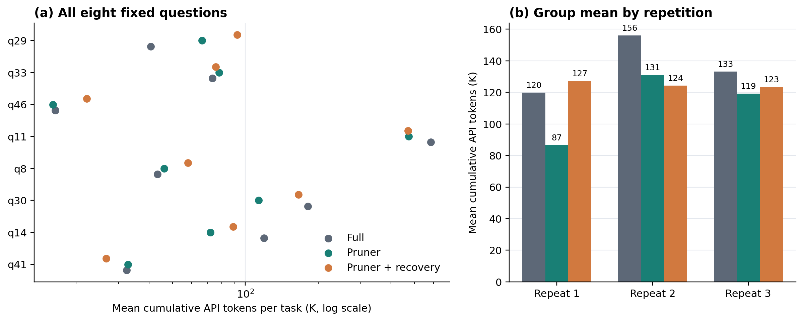

# SWE-Pruner Reproduction and Bounded Observation Recovery

Xia Feifan · 1155204948

FTEC5660 Individual Reproducibility Project · November 2026

Reproduction result for Streamlink with GLM-4.6

## Abstract

We reproduce SWE-Pruner in the released OpenHands and SWE-QA pipeline, targeting the Streamlink and GLM-4.6 cells of Table 2. The experiment completes 72 repository-answering executions over eight fixed questions, three conditions and three repetitions. Full observations, original optional-hint pruning, and pruning with recoverable observations use 136.4K, 112.3K and 125.1K mean cumulative API tokens and score 9.00, 9.12 and 9.24 out of 10. Relative to full output, pruning reduces tokens by 17.6% and increases mean quality by 1.3%; pruning activates in 6 of 24 tasks. Our modification stores every captured Bash output as task-local evidence and adds an `expand` tool that returns at most 200 original lines. It turns pruning into a recoverable filter. Recovery adds 11.3% tokens to pruning and raises mean quality by 1.4%, with a quality interval of [-2.0%, +4.0%]. This batch reproduces the direction of token reduction; the author reference reaches 49.9%, and the gap tracks hint coverage and investigation paths.

## 1. Introduction

Coding agents repeatedly search and read repositories. A large tool observation becomes part of every later request, so the cost of early evidence grows with the investigation path. SWE-Pruner uses a 0.6B neural skimmer to select lines relevant to the agent's current focus question before the observation enters the conversation [1]. A reproduction must measure both the shorter observation and the complete task outcome: pruning can save context while also causing additional searches, rereading or missing evidence.

Our target is the authors' `downstream_eval/multi_turn/sweqa` implementation at commit 96171b5 [2]. OpenHands provides the agent loop and Bash tool, SWE-QA provides questions, reference answers and scoring, and SWE-Pruner filters captured output. This report covers Streamlink with GLM-4.6 in Table 2.

The experiment uses one fixed batch with three conditions: full observations, original optional-hint pruning, and pruning with bounded recovery. Three repetitions measure online variation under one configuration. The author archive has one run for each of the same eight questions; tables state the sample count for the author reference and the local repetitions.

The modification stores every captured tool observation and exposes `expand(observation_id, start, end)`, which returns at most 200 original lines. It restores access to original evidence after pruning while retaining the costs of the index hint, extra tool turns and recovered text entering history. The 72 cells use one question set, denominator and scoring rule.

### 1.1 Research questions

RQ1 asks whether full output and original optional-hint pruning differ in cumulative API tokens and five-dimensional quality in the direction reported by the paper. RQ2 asks which observable path behaviors explain the remaining gap to the authors' same-eight-question records, especially activation, request count and long-path tasks. RQ3 asks whether task-local recovery can access evidence hidden by pruning and what it changes in quality, tokens and requests.

The questions share one 72-cell experiment. RQ1 uses 48 paired full/pruner cells, RQ2 uses their trajectories and the author records, and RQ3 compares 24 recovery cells with the 24 corresponding pruner cells.

### 1.2 Contributions

First, we complete 72 executions over the fixed Streamlink questions with answers, scores and transmitted-request usage for every selected cell. Second, we measure full, optional-hint pruning and bounded recovery under one configuration, with question-cluster intervals and question-level decomposition. Third, we connect the gap to the author records with hint coverage, request counts, long paths and serving conditions, giving the reproduction result an auditable explanation.

## 2. Method and Modification

### 2.1 Released pruning behavior

A Bash action may include an optional `context_focus_question`. When the field is nonempty, the executor sends the output and focus question to the skimmer; when it is empty, the full output is returned. The released tool instructions permit blank hints for short important outputs and recommend line-numbered full reads followed by narrower commands. Filtering occurs when the field is nonempty, and trajectories record actual activation.

The skimmer processes chunks padded to at most 8192 positions, merges overlapping token scores, maps character scores to lines and retains lines meeting the 0.5 threshold. It also inserts line-count markers where text is deleted [2,3]. We use the released checkpoint and preserve the threshold, chunking and line logic. Parameters follow the published loading behavior in FP32, the forward pass uses FP16 autocast, and logits are converted back to FP32. Query-axis SDPA tiles of 256 preserve the complete key/value context and fit the local 8GB GPU.

Cumulative API tokens are C = Σₜ(Iₜ + Oₜ), including cached input and provider-counted reasoning output. Source compression is 1 − Σ kept / Σ raw using the skimmer tokenizer. Results report the cumulative usage of the complete path and the compression of observations that reach the skimmer.

### 2.2 Our modification: recoverable pruning

After Bash captures stdout, our modification stores the complete text and derives an observation identifier from its content hash. The visible observation includes the identifier and original line count. An `expand` call returns an inclusive, one-based range of at most 200 lines. Invalid identifiers, out-of-range requests and oversized ranges return explicit errors. The store records requested ranges, returned characters and repeated lines. The pruned observation remains the default working context, and the original evidence stays recoverable within the same task after the agent's focus changes.

The store contains the executor-visible observation, and `expand` addresses positions in that saved observation. Numbers printed by `cat -n` are source-file lines. Each task runs in its own process and storage lifetime. `observation_store.py` uses the Python standard library, while the OpenHands binding is isolated in `recovery_tool.py`.

The functional target is access to exact captured evidence after pruning. The cost target counts recovered text, extra turns and request history in the complete task. Successful and invalid expansions are therefore retained in the same task-level analysis.

### 2.3 Measurement and failure handling

Token statistics come from per-request provider usage. The released runner accumulates both `accumulated_token_usage` and `token_usages`, creating a double count. An independent ledger removes the double count and records model, provider, input, output, cached and reasoning tokens for every request. All tables use this ledger.

Every scheduled cell retains its first trajectory. Missing answers, process failures, pruning-service failures and missing usage receipts permit one documented infrastructure retry. Judge transport or format failures retry on the saved answer. Scores never trigger agent replacement. Original attempts, retry attempts, judge responses and the selection rule have attempt-specific directories; final tables use answers that satisfy execution and receipt completeness.

Recovery stores the text visible to the agent. For summaries generated after the 50-step limit, the released implementation reads an empty inherited `content` field and serializes actual observations as empty evidence. Original trajectories remain unchanged. The implementation audit fixes this terminal serialization path; the original execution results remain intact.

## 3. Experimental Design

### 3.1 Fixed experiment batch

The fixed zero-based indices are 41, 14, 30, 8, 11, 46, 33 and 29. Three conditions each repeat three times, producing 8 × 3 × 3 = 72 primary cells. Questions, initial prompts, tool schemas, repository snapshot and scoring rubric remain shared; only filtering and recovery differ.

| Component | Shared configuration |
|---|---|
| Agent | GLM-4.6; fixed Z.AI route; provider fallback disabled |
| Judge | GPT-5; released five-dimensional JSON rubric; fixed OpenAI route |
| Generation | temperature 0; top_p 1; maximum output 16,384 |
| Limits | 50 interaction steps; 1800 seconds per question |
| Sources | SWE-Pruner 96171b5; Streamlink ab1f365 |
| Skimmer | Released checkpoint; FP32 parameters; FP16 autocast; threshold 0.5 |
| Runtime | Windows 11 / WSL Ubuntu 22.04; Python 3.12; OpenHands SDK 1.1.0 |
| Numerical stack | PyTorch 2.9.0.dev20250705+cu129; Transformers 4.57.1; 8GB GPU |

Table 1. Shared configuration for the 72-cell experiment.

API credentials were supplied through local environment variables and kept outside the agent sandbox and evidence archive; the repository and evidence contain only provider names and routes.

### 3.2 Metrics and inference

Quality is the mean of correctness, completeness, relevance, clarity and reasoning, each scored from 1 to 10. Relative changes use `100 × (treatment/control − 1)`. Confidence intervals treat questions as clusters: we first average the three repetitions within each question and then perform 10,000 paired bootstrap resamples with seed 5660. The runs use temperature zero but no independent provider seed claim.

Every scheduled cell retains its first trajectory. Missing answers, process failures, pruning-service failures and missing usage receipts permit one documented infrastructure retry. Judge transport or format failures retry only on the saved answer. Scores never trigger agent replacement. First-attempt completeness is 81.9%, and final completeness is 100.0%.

## 4. Results

### 4.1 Paper and author comparison

The authors' public runs and Table 2 have a token-field correspondence issue. Recomputing the Streamlink records gives 142.3K → 101.2K, while the paper row reports 318.2K → 145.1K. We preserve both sources and use the same-eight-question records for the closest task comparison. Author scores below use their unfiltered eight-question denominator; local results retain all repetitions and tasks.

| Source and condition | Executions (n) | Quality / 10 (↑) | Tokens K (↓) | Token change (↓) |
|---|---:|---:|---:|---:|
| Paper Streamlink full | 48 | 8.56 | 318.2 | control |
| Paper Streamlink pruner | 48 | 8.56 | 145.1 | -54.4% |
| Author same eight, full | 8 | 8.25 | 190.2 | control |
| Author same eight, pruner | 8 | 8.60 | 95.3 | -49.9% |
| Local full | 24 | 9.00 | 136.4 | control |
| Local pruner | 24 | 9.12 | 112.3 | -17.6% |
| Local pruner + recovery | 24 | 9.24 | 125.1 | -8.3% vs full |

Table 2. Published, author-record and local comparisons. K denotes 1000 tokens.

Metric direction: ↑ higher is better, ↓ lower is better, and n denotes sample size. Later result tables use the same markers; ==BEST== marks the best value within a comparable set, and {{green numbers}} mark improvement over the reference condition.

The fixed local batch reproduces the direction of the author reference with a 17.6% token reduction and a 1.3% quality increase. The author reduction is 49.9%. On the identical questions, absolute savings are 94.9K per task in the author records and 24.0K locally. Author full output is 190.2K, and local full output is 136.4K. Table 2 gives each source its own row.

### 4.2 Tokens, quality and investigation paths

Group mean tokens are 119.9K, 156.1K and 133.1K for full across the three repetitions, 86.6K, 131.1K and 119.3K for pruning, and 127.4K, 124.4K and 123.5K for recovery. Pruning lowers the group mean in every repetition, but question-level differences are large. The question-cluster intervals are [-29.5%, +8.7%] for tokens and [-0.4%, +3.2%] for quality.

| Condition | Mean quality (↑) | Mean tokens K (↓) | Mean requests (↓) | Mean rounds (↓) | Pruning coverage (↑) |
|---|---:|---:|---:|---:|---:|
| full | 9.00 | 136.4 | 12.71 | 15.42 | 0.0% |
| pruner | 9.12 | ==112.3 BEST== | ==10.46 BEST== | 14.25 | ==25.0% BEST== |
| pruner + recovery | ==9.24 BEST== | 125.1 | 11.08 | ==13.92 BEST== | 16.7% |

Table 3. Group means over eight fixed questions and three repetitions.

| Question | Full tokens K (↓) | Pruner tokens K (↓) | Recovery tokens K (↓) | Full / pruner / recovery quality (↑) |
|---|---:|---:|---:|---|
| q41 | 32.3 | 32.8 | ==26.7 BEST== | 8.67 / 8.67 / ==9.13 BEST== |
| q14 | 119.6 | ==71.8 BEST== | 89.1 | 9.67 / 9.40 / ==9.87 BEST== |
| q30 | 181.6 | ==113.4 BEST== | 166.1 | 9.00 / 9.07 / ==9.13 BEST== |
| q8 | ==43.3 BEST== | 46.2 | 58.0 | 9.33 / 9.47 / ==9.60 BEST== |
| q11 | 584.0 | 474.2 | ==470.3 BEST== | 8.13 / ==8.67 BEST== / 7.87 |
| q46 | 16.4 | ==16.0 BEST== | 22.2 | 9.33 / 9.60 / ==9.73 BEST== |
| q33 | ==73.1 BEST== | 78.0 | 75.5 | 8.20 / 8.47 / ==9.00 BEST== |
| q29 | ==40.7 BEST== | 66.3 | 92.7 | ==9.67 BEST== / 9.60 / 9.60 |

Table 4. Question means over three repetitions. K denotes 1000 tokens.

| Condition | Correctness (↑) | Completeness (↑) | Relevance (↑) | Clarity (↑) | Reasoning (↑) |
|---|---:|---:|---:|---:|---:|
| full | 8.71 | 9.25 | 9.21 | 9.00 | 8.83 |
| pruner | 8.71 | 9.33 | ==9.42 BEST== | ==9.08 BEST== | 9.04 |
| recovery | ==9.08 BEST== | ==9.50 BEST== | 9.33 | ==9.08 BEST== | ==9.21 BEST== |

Table 5. Five-dimensional mean scores. Recovery changes correctness and completeness most.

| Repetition | Full tokens K (↓) / quality (↑) | Pruner tokens K (↓) / quality (↑) | Recovery tokens K (↓) / quality (↑) |
|---|---|---|---|
| 1 | 119.9 / 9.15 | ==86.6 BEST== / 9.00 | 127.4 / ==9.33 BEST== |
| 2 | 156.1 / 8.98 | 131.1 / 9.05 | ==124.4 / 9.13 BEST== |
| 3 | 133.1 / 8.88 | ==119.3 / 9.30 BEST== | 123.5 / 9.28 |

Table 6. Group means by repetition. Each repetition contains the same eight questions.

The pruning reduction factorizes into 17.7% fewer requests and 0.1% more tokens per request. Savings primarily reflect shorter paths. Six of 254 Bash actions carry a hint, and task activation is 6/24. In the authors' same-question records, all 131 Bash actions carry a hint. Local savings coincide with shorter request paths.

### 4.3 Effect and cost of our modification

| Comparison | Quality (↑) | Tokens (↓) | Requests (↓) | Question-cluster intervals (quality ↑, tokens ↓) |
|---|---:|---:|---:|---|
| pruner vs full | {{+0.12 (+1.3%, improvement)}} | {{-24.0K (-17.6%, improvement)}} | {{-17.7% (improvement)}} | quality [-0.4%, +3.2%]; tokens [-29.5%, +8.7%] |
| recovery vs pruner | {{+0.12 (+1.4%, improvement)}} | +12.7K (+11.3%, added cost) | +6.0% (added cost) | quality [-2.0%, +4.0%]; tokens [+0.9%, +35.4%] |

Table 7. Results of our recoverable-pruning modification.

Recoverable pruning raises mean quality from 9.12 to 9.24 (+1.4%), with correctness increasing from 8.71 to 9.08 and completeness from 9.33 to 9.50; mean tokens rise from 112.3K to 125.1K (+11.3%).

Recovery occurs in 3 of 24 tasks. Twelve successful reads return 51,480 characters and repeat two lines. Every successful slice matches the original observation and exposes previously unseen nonblank text. Seven requests exceed 200 lines and two use invalid ranges; their errors, turns and tokens remain included. The token overhead is well supported, and the small quality increase remains uncertain.

Recovery runs in 3/24 tasks. Twelve successful reads, 51,480 returned characters, 21 expansion tool turns, seven overlong requests and two invalid ranges all enter the task-level statistics.

| Recovery audit | Value (n) |
|---|---:|
| Tasks using recovery | 3 / 24 |
| Stored observations | 217 |
| Stored text | 1,305,860 bytes |
| Successful expansions | 12 |
| Expansion tool turns | 21 |
| Returned characters | 51,480 |
| Repeated lines | 2 |
| Requests over 200 lines | 7 |
| Invalid ranges | 2 |

Table 8. Task-level recovery audit. Invalid requests remain in the execution and token counts.

## 5. Discussion

### 5.1 Mechanism

Within this controlled eight-question batch, SWE-Pruner shows the expected trade: the full-output path costs more, mean quality rises slightly after pruning, and mean tokens fall. End-to-end benefit depends on the agent's pruning activation, path length and use of omitted evidence.

Question heterogeneity is substantial. q11 uses 584.0K tokens in full and 474.2K in pruning; q14 uses 119.6K and 71.8K. In contrast, q29 increases from 40.7K to 66.3K, and recovery uses 92.7K. q8 changes little. The unweighted mean across eight questions gives long paths influence over aggregate tokens, while quality differences remain small on the ten-point scale.

Recovery changes q14, q33 and q41 in different ways. q11 recovery scores 7.87 versus 8.67 in pruning at similar tokens. The recovered ranges and their use in reasoning determine the result. Recovery averages 11.08 requests versus 10.46 in pruning, so extra turns and returned text form a visible part of the cost.

### 5.2 Operating Conditions

The authors run through their own model gateway; their records omit some inference internals and the downloaded checkpoint revision. The local run uses the GLM-4.6 Z.AI route. Both use the same eight questions and follow different online paths. GPT-5 with the five-dimensional rubric checks reference coverage, clarity and reasoning.

Two engineering audits affect the numbers. The released runner double-counts provider usage across simultaneous accumulation paths, so the analysis uses the independent per-request ledger. At the 50-step limit, the released terminal-summary branch serializes actual Bash observations as `Observation: []`. Complete-path outputs and terminal-repair outputs each have dedicated evidence files.

## 6. Reproducibility and Completeness

### 6.1 Execution and failures

All 72 primary executions have answers, scores and transmitted-request usage. Final completeness is 100.0%; first-attempt completeness is 81.9%, with 79.2% for full/pruner and 87.5% for recovery. Network resets, DNS/SSL failures, missing receipts and judge transport failures remain as failed attempts. Retries are infrastructure-only; chosen answers are never replaced for low scores.

The 24 recovery cells include three infrastructure retries; the 48 full/pruner cells include ten. Every retry occurs at answer export, process, pruning-service or usage-receipt stages. Judge retries use the same saved answer and accept the first valid five-dimensional JSON response. Connection resets and DNS/SSL errors caused by network and VPN transitions have dedicated logs.

| Blocker | Observed symptom | Resolution | Effect on the study |
|---|---|---|---|
| Workspace path mismatch | The agent could not see the intended repository snapshot | Mounted the shared `swe-repos` root read-only and restored the 50-step limit | All cells used the same task workspace |
| Numerical-setting mismatch | Padding and precision differed from the released behavior | Restored 8192-position padding, FP32 parameters, FP16 autocast and query-tiled SDPA | The checkpoint fit the local 8GB GPU while preserving the model context |
| Token double counting | The runner summed aggregate usage and per-request usage together | Used an independent ledger with one provider-usage record per request | Every reported token count uses transmitted-request usage |
| Terminal-summary evidence loss | The 50-step summary serialized real Bash observations as `Observation: []` | Fixed the terminal serializer and preserved original and repaired branches separately | Evidence remains visible while the original execution result stays unchanged |
| Network and provider interruptions | DNS/SSL resets, missing usage receipts and answer-export failures | Kept every failed attempt and applied one bounded infrastructure retry; judge retries reused the saved answer | Final execution completeness reached 72/72 |
| Optional-hint activation gap | Author records use hints in 131/131 Bash actions; the local pruner uses 6/254 | Reported activation as an operating-condition difference instead of forcing hints | The 49.9% versus 17.6% gap has a measured path explanation |

Table 9. Debug diary. Engineering changes are separated from the measured recovery modification.

### 6.2 Artifacts and resources

Frozen protocols, source hashes, question inputs, trajectories, answers, judge responses and request usage form the provenance chain. The fixed batch uses 5,969,294 + 3,001,723 API tokens. Under the project's conservative accounting, the 48 full/pruner cells cost approximately $1.27 and the 24 recovery cells approximately $0.65, or $1.92 for the batch.

The repository includes installation and execution instructions. Original failures, retries and judge attempts have attempt-specific directories. Tables use selected complete executions while preserving every attempt for audit. The student prepares the recording and presentation; AI assisted implementation, analysis and manuscript preparation.

| Artifact | Content |
|---|---|
| Code | SWE-Pruner commit 96171b5; Streamlink commit ab1f365 |
| Data | Fixed eight questions, references and read-only repository snapshot |
| Protocol | Conditions, repetitions, generation parameters, rubric and retry rules |
| Evidence | Answers, trajectories, raw API responses and per-request usage |
| Analysis | Table generation, cluster bootstrap and question summaries |
| Verification | 23 unit tests, source hashes and execution-completeness audit |

Table 10. Reproducibility artifact checklist.

## 7. Conclusion

In a complete eight-question, three-repetition batch, SWE-Pruner reduces mean cumulative API tokens from 136.4K to 112.3K (-17.6%) while mean quality rises from 9.00 to 9.12. The direction is reproduced, but the reduction is below the author reference of -49.9%, with hint use and long-path behavior explaining part of the difference. Bounded original-observation recovery raises quality from 9.12 to 9.24 and tokens to 125.1K; its access function is clear, while its mean quality benefit remains uncertain.

On this fixed Streamlink evaluation set, SWE-Pruner reproduces the end-to-end direction of token reduction and mean quality moves from 9.00 to 9.12. The author reference of 49.9%, population-level generalization and recovery economics require larger and more closely aligned experiments.

## References

[1] Yuhang Wang, Yuling Shi, Mo Yang, Rongrui Zhang, Shilin He, Heng Lian, Yuting Chen, Siyu Ye, Kai Cai, Xiaodong Gu. SWE-Pruner: Self-Adaptive Context Pruning for Coding Agents. arXiv:2601.16746v1, 2026. [Paper](https://arxiv.org/abs/2601.16746v1)

[2] SWE-Pruner implementation and released SWE-QA artifacts, commit 96171b5f3ecaf89745cbeb436c8893b57f3400bd. [Repository](https://github.com/Ayanami1314/swe-pruner/tree/96171b5f3ecaf89745cbeb436c8893b57f3400bd)

[3] code-pruner checkpoint, revision 863cee3198c715c9df1faa422a3490e0832bb734. [Checkpoint](https://huggingface.co/ayanami-kitasan/code-pruner/tree/863cee3198c715c9df1faa422a3490e0832bb734)

[4] OpenRouter Provider Routing. Accessed November 11, 2026. [Documentation](https://openrouter.ai/docs/guides/routing/provider-selection)
