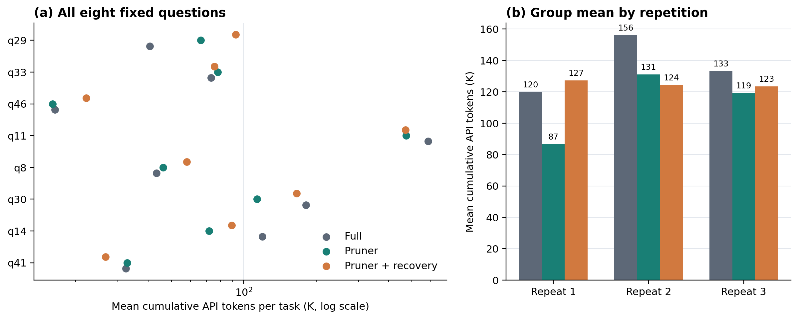

# SWE-Pruner 复现与有界原始观测恢复

Xia Feifan · 1155204948

FTEC5660 Individual Reproducibility Project · 2026 年 11 月

SWE-Pruner 在 Streamlink 与 GLM-4.6 条件上的复现结果

## 摘要

本文复现 SWE-Pruner 在 OpenHands 执行框架与 SWE-QA 仓库问答任务中的表现，数值目标为论文表 2 的 Streamlink × GLM-4.6 条件。实验固定八题、三种条件和三次重复，共完成 72 项问答。完整输出、原始可选提示剪枝、以及剪枝加可恢复观测三组的平均累计 API tokens 分别为 136.4K、112.3K 和 125.1K，平均评分分别为 9.00、9.12 和 9.24。相对于完整输出，剪枝平均节省 17.6% tokens，评分提高 1.3%；剪枝在 24 个任务中的 6 个实际触发。本文的修改把每次 Bash 捕获的完整输出保存为任务级证据，并提供最多返回 200 行的 `expand` 工具。该修改把剪枝从不可逆删除变成可追溯、可恢复的过滤，在剪枝基础上增加 11.3% tokens，并把评分提高 1.4%；质量区间为 [−2.0%, +4.0%]。这批实验复现了 token 下降方向；作者同题记录为 49.9%，本地为 17.6%，差距与 hint 覆盖和调查路径相关。

## 1. 引言

编程 Agent 会在多轮调查中反复读取文件和搜索代码。一次较大的工具输出会进入后续请求的上下文，路径越长，早期内容的累计成本越高。SWE-Pruner 使用一个 0.6B neural skimmer，根据 Agent 当前的关注问题选择工具输出中的代码行，再让 Agent 基于保留文本继续工作 [1]。复现的关键在于同时观察局部文本压缩与完整任务结果：压缩能减少单次观测，也可能诱发额外搜索、重读或答案遗漏。

本文复现作者仓库中的 `downstream_eval/multi_turn/sweqa` 流程，固定 commit 为 96171b5 [2]。OpenHands 提供 Agent 循环与 Bash 工具，SWE-QA 提供仓库问题、参考答案和评分规则，SWE-Pruner 位于工具输出进入模型上下文之前。本报告的实验范围是论文表 2 的 Streamlink 与 GLM-4.6 条件。

实验在一个固定八题批次中比较三种条件：完整输出、原始可选提示剪枝、以及剪枝加有界恢复。三次重复用于观察同一配置下的在线模型差异。作者公开记录中这八题每题运行一次；表格按作者一次运行与本地三次重复分别标注样本数量。

本文新增的修改保留每次 Bash 捕获的完整文本，并允许 Agent 通过 `expand(observation_id, start, end)` 精确取回最多 200 行。这样可以在剪枝造成证据缺失后恢复原始内容，同时保留索引提示、额外工具回合和取回文本进入历史的实际成本。这 72 项实验使用同一题目集合、分母和评分规则。

### 1.1 研究问题

本文围绕三个问题组织证据。RQ1 检验完整输出与原始可选提示剪枝在相同题目和重复次数下，累计 API tokens 与五维质量是否呈现论文报告的方向。RQ2 检验本地与作者同一八题记录之间的差距由哪些可观测路径行为解释，尤其是剪枝触发率、请求数和单题长路径。RQ3 检验任务级原始观测恢复能否在剪枝协议内取回被隐藏的原始证据，并量化它对质量、tokens 和请求数的影响。

三个问题共用一批 72 项实验。RQ1 使用 full 与 pruner 的 48 项配对比较，RQ2 使用同一批轨迹和作者公开记录，RQ3 使用 24 项 pruner + recovery 与相同题目的 24 项 pruner 对照。

### 1.2 主要贡献

第一，完成固定 Streamlink 八题的 72 项完整执行，所有任务都有答案、评分和 transmitted-request usage。第二，在统一配置下重复测量 full、可选提示剪枝与有界恢复，并给出问题 cluster 区间和逐题分解。第三，把本地与作者记录的差异落实到 hint 覆盖、请求数、长路径和模型服务实现，使复现结论具有可核查的解释。

## 2. 方法与修改

### 2.1 SWE-Pruner 的剪枝行为

Agent 生成 Bash 命令时，可以附带一个可选的 `context_focus_question`。字段非空时，执行器把工具输出与关注问题发送给本地 skimmer；字段为空时，直接返回完整输出。发布工具说明允许为短而重要的结果省略 hint，并建议通过带行号读取与后续局部命令查看细节。文本过滤发生在 hint 非空时，实际覆盖率由轨迹统计。

skimmer 将输入切分为最多 8192 位置的分块，合并重叠 token 的分数，再把字符分数映射到行。行分数达到阈值 0.5 时保留，并在删除位置插入行数标记 [2,3]。本文使用发布 checkpoint，保持阈值、分块和行处理逻辑不变。参数按论文发布环境的默认行为加载为 FP32，forward 使用 FP16 autocast，logits 再转回 FP32。查询轴分块 SDPA 保留完整 key/value 上下文，使实验能够在本地 8GB GPU 上运行。

累计 API tokens 定义为 C = Σₜ(Iₜ + Oₜ)，其中输入包含缓存命中的 tokens，输出包含服务商计入的 reasoning tokens。局部压缩率定义为 1 − Σ kept / Σ raw，使用 skimmer tokenizer。结果分别报告完整对话路径的累计用量和送入 skimmer 的观测压缩率。

### 2.2 本文修改：可恢复剪枝

本文修改在 Bash 执行器捕获 stdout 后保存完整文本，以内容哈希生成观测 ID，并把 ID 与原始行数加入 Agent 可见的观测。Agent 调用 `expand` 时，系统按照从 1 开始的闭区间返回原始文本切片，每次最多 200 行。未知 ID、越界范围和超长请求返回明确错误。记录包含请求范围、返回字符数以及重复读取行数。这项修改把剪枝后的上下文变成可恢复视图：默认路径继续使用筛选后的短观测，Agent 在关注点变化后可以返回同一任务的原始证据。

保存内容是执行器整理后的完整观测，`expand` 的行位置基于这份观测。`cat -n` 等命令打印的数字是源文件行号，工具提示按保存观测的一基闭区间返回。每个任务使用独立进程和独立存储生命周期。底层 `observation_store.py` 只依赖 Python 标准库，OpenHands 适配集中在 `recovery_tool.py`，便于独立复用和测试。

恢复的功能目标是“能够取回已经捕获但被剪枝隐藏的原文”，成本目标是“把取回行为完整计入 tokens 和请求数”。因此，本文同时记录成功恢复、无效请求、额外回合、返回字符与重复行，并把它们保留在任务级结果中。

### 2.3 计量与失败处理

本文的 token 统计来自逐请求 API usage。发布的 runner 同时累加 `accumulated_token_usage` 与 `token_usages`，真实调用因此形成双计；独立账本消除双计，并保留每次请求的模型、provider、输入、输出、缓存命中与 reasoning tokens。所有表格都使用该账本。

每个计划项保留首轮轨迹。缺少答案、进程失败、剪枝服务失败或缺失 usage 回执时，允许一次明确标记的基础设施补跑。评分传输或格式失败只对已经保存的答案重新请求。评分高低不触发 Agent 重跑。原始 attempt、补跑 attempt、评分响应和选中规则保留在独立目录，最终实验表只引用满足执行与回执完整性的答案。

观测恢复保存的是 Agent 实际可见的文本。对于达到 50 步后生成的终止摘要，发布实现优先读取空的继承 `content` 字段，导致已完成调查的证据在最后一步消失。本文保留原始轨迹，并在实现审计中修复这一序列化路径。该修复用于解释证据完整性，原始执行结果保持不变。

## 3. 实验设计

### 3.1 固定实验批次

固定零基题号为 41、14、30、8、11、46、33、29。这三项条件各重复三次，形成 8 × 3 × 3 = 72 项主实验。所有题目、首轮提示词、工具 schema、仓库快照和评分 rubric 在三种条件之间保持一致，只有执行器的过滤与恢复能力不同。

| 项目 | 统一配置 |
|---|---|
| Agent | GLM-4.6；固定 Z.AI 路由；provider fallback 关闭 |
| 评分 | GPT-5；作者五维 JSON rubric；固定 OpenAI 路由 |
| 生成 | temperature 0；top_p 1；最大输出 16,384 tokens |
| 执行 | 最多 50 次交互；每题最多 1,800 秒 |
| 来源 | SWE-Pruner 96171b5；Streamlink ab1f365 |
| Pruner | 发布 checkpoint；FP32 参数；FP16 autocast；阈值 0.5 |
| 运行环境 | Windows 11 / WSL Ubuntu 22.04；Python 3.12；OpenHands SDK 1.1.0 |
| 数值环境 | PyTorch 2.9.0.dev20250705+cu129；Transformers 4.57.1；8GB GPU |

表 1. 72 项主实验的统一配置。

### 3.2 指标与统计推断

质量为 correctness、completeness、relevance、clarity、reasoning 五维分数的均值，范围 1–10。相对变化采用 `(处理组/对照组 − 1) × 100%`。置信区间把问题视为 cluster，先计算每个问题三次重复的均值，再做 10,000 次配对 bootstrap，随机种子为 5660。三次执行用于观察在线服务差异，温度为零不代表服务商提供独立 seed。

每个计划项保留首轮轨迹。缺少答案、进程失败、剪枝服务失败或缺失 usage 回执时，允许一次明确标记的基础设施补跑。评分传输或格式失败只对同一份已保存答案重新请求。评分高低不触发 Agent 重跑，所有失败、补跑和评分响应均保留。完整批次的首轮完成率为 81.9%，最终完成率为 100.0%。

## 4. 实验结果

### 4.1 与论文及作者记录对照

作者公开运行记录与论文表 2 之间存在 token 字段对应差异。Streamlink 的公开记录复算为 142.3K → 101.2K，论文该行写为 318.2K → 145.1K。为保留任务范围一致，本文同时报告论文、作者同一八题记录和本地 72 项结果。作者同一八题每题只运行一次，评分采用未经筛选的全部八题；本地结果保留三次重复和全部任务。

| 来源与条件 | 执行项 (n) | 评分 / 10 (↑) | tokens K (↓) | 相对 tokens (↓) |
|---|---:|---:|---:|---:|
| 论文 Streamlink full | 48 | 8.56 | 318.2 | 对照 |
| 论文 Streamlink pruner | 48 | 8.56 | 145.1 | −54.4% |
| 作者同一八题 full | 8 | 8.25 | 190.2 | 对照 |
| 作者同一八题 pruner | 8 | 8.60 | 95.3 | −49.9% |
| 本地 full | 24 | 9.00 | 136.4 | 对照 |
| 本地 pruner | 24 | 9.12 | 112.3 | −17.6% |
| 本地 pruner + recovery | 24 | 9.24 | 125.1 | −8.3% vs full |

表 2. 论文、作者公开记录与本地实验结果。所有 tokens 使用 K=1000；作者评分使用其公开的未筛选八题结果。

指标方向：↑ 越大越好，↓ 越小越好，n 为样本量。后续结果表沿用相同标记；==BEST== 标出同一可比集合中的最优值，{{绿色数字}} 表示相对对照的改善。

本地固定批次得到 17.6% 的 token 降低和 1.3% 的评分提高，方向与作者同一八题记录一致。作者记录的降幅为 49.9%，本地为 17.6%。相同八题的绝对节省在作者记录中为 94.9K，在本地为 24.0K；作者 full 路径为 190.2K，本地为 136.4K。全仓库参考与固定批次在表 2 中分行列出。

### 4.2 Token、质量与调查路径

三次重复的平均 tokens 分别为 full 119.9K、156.1K、133.1K，pruner 为 86.6K、131.1K、119.3K，恢复组为 127.4K、124.4K、123.5K。三次重复中，剪枝的组均值都低于完整输出，但问题级差异很大。问题 cluster 的 95% 区间为 token [−29.5%, +8.7%]、质量 [−0.4%, +3.2%]，说明八个问题的平均方向稳定，样本仍不足以支持“所有任务都节省”的结论。

| 条件 | 平均评分 (↑) | 平均 tokens K (↓) | 平均请求数 (↓) | 平均轮数 (↓) | 剪枝覆盖 (↑) |
|---|---:|---:|---:|---:|---:|
| full | 9.00 | 136.4 | 12.71 | 15.42 | 0.0% |
| pruner | 9.12 | ==112.3 BEST== | ==10.46 BEST== | 14.25 | ==25.0% BEST== |
| pruner + recovery | ==9.24 BEST== | 125.1 | 11.08 | ==13.92 BEST== | 16.7% |

表 3. 固定八题、三次重复的组均值。剪枝覆盖按 24 个任务计算。

| 题号 | full tokens K (↓) | pruner tokens K (↓) | recovery tokens K (↓) | full / pruner / recovery 评分 (↑) |
|---|---:|---:|---:|---|
| q41 | 32.3 | 32.8 | ==26.7 BEST== | 8.67 / 8.67 / ==9.13 BEST== |
| q14 | 119.6 | ==71.8 BEST== | 89.1 | 9.67 / 9.40 / ==9.87 BEST== |
| q30 | 181.6 | ==113.4 BEST== | 166.1 | 9.00 / 9.07 / ==9.13 BEST== |
| q8 | ==43.3 BEST== | 46.2 | 58.0 | 9.33 / 9.47 / ==9.60 BEST== |
| q11 | 584.0 | 474.2 | ==470.3 BEST== | 8.13 / ==8.67 BEST== / 7.87 |
| q46 | 16.4 | ==16.0 BEST== | 22.2 | 9.33 / 9.60 / ==9.73 BEST== |
| q33 | ==73.1 BEST== | 78.0 | 75.5 | 8.20 / 8.47 / ==9.00 BEST== |
| q29 | ==40.7 BEST== | 66.3 | 92.7 | ==9.67 BEST== / 9.60 / 9.60 |

表 4. 每个固定题目的三次重复均值。tokens 使用 K=1000，评分为五项维度均值。

| 条件 | correctness (↑) | completeness (↑) | relevance (↑) | clarity (↑) | reasoning (↑) |
|---|---:|---:|---:|---:|---:|
| full | 8.71 | 9.25 | 9.21 | 9.00 | 8.83 |
| pruner | 8.71 | 9.33 | ==9.42 BEST== | ==9.08 BEST== | 9.04 |
| recovery | ==9.08 BEST== | ==9.50 BEST== | 9.33 | ==9.08 BEST== | ==9.21 BEST== |

表 5. 五维评分的组均值。recovery 的主要变化出现在 correctness 与 completeness。

| 重复 | full tokens K (↓) / 评分 (↑) | pruner tokens K (↓) / 评分 (↑) | recovery tokens K (↓) / 评分 (↑) |
|---|---|---|---|
| 第 1 次 | 119.9 / 9.15 | ==86.6 BEST== / 9.00 | 127.4 / ==9.33 BEST== |
| 第 2 次 | 156.1 / 8.98 | 131.1 / 9.05 | ==124.4 / 9.13 BEST== |
| 第 3 次 | 133.1 / 8.88 | ==119.3 / 9.30 BEST== | 123.5 / 9.28 |

表 6. 每个重复的组均值。tokens 使用 K=1000；同一重复包含相同八题。

剪枝组的 token 降低分解为请求数下降 17.7% 和每请求 tokens 增加 0.1%，节省主要来自调查路径变短。原始可选提示批次共执行 254 次 Bash action，其中 6 次带 hint，任务级覆盖为 6/24。作者同一八题记录的 131 次 Bash action 全部带 hint，任务覆盖为 100%。本地节省与请求路径缩短同步出现。

### 4.3 本文修改的效果与代价

| 比较 | 评分变化 (↑) | tokens 变化 (↓) | 请求数变化 (↓) | 问题 cluster 区间（评分 ↑，tokens ↓） |
|---|---:|---:|---:|---|
| pruner vs full | {{+0.12 分（+1.3%，提升）}} | {{−24.0K（−17.6%，改善）}} | {{−17.7%（改善）}} | 评分 [−0.4%, +3.2%]；tokens [−29.5%, +8.7%] |
| pruner + recovery vs pruner | {{+0.12 分（+1.4%，提升）}} | +12.7K（+11.3%，成本增加） | +6.0%（成本增加） | 评分 [−2.0%, +4.0%]；tokens [+0.9%, +35.4%] |

表 7. 本文可恢复剪枝修改的结果。评分差为十点量表上的组均值差；tokens 使用问题 cluster 配对统计。

可恢复剪枝把平均质量从 9.12 提升到 9.24（+1.4%），correctness 从 8.71 提升到 9.08、completeness 从 9.33 提升到 9.50；同时平均 tokens 从 112.3K 增加到 125.1K（+11.3%）。

恢复条件在 24 个任务中的 3 个实际调用扩展工具，共完成 12 次成功读取，返回 51,480 个字符并重复读取 2 行。所有成功切片均逐字符匹配原始观测，且至少包含此前未显示的非空文本。另有 7 次请求超过 200 行上限、2 次范围越界，错误提示和额外回合均计入 tokens。恢复的 token 代价比质量变化更明确，质量均值虽提高 1.4%，区间仍跨零。

恢复在 3/24 个任务中触发。12 次成功读取、51,480 个返回字符、21 个 expand 工具回合、7 次超长范围和 2 次越界均进入任务级统计。

| 恢复审计项 | 数值 (n) |
|---|---:|
| 触发恢复的任务 | 3 / 24 |
| 存储的原始观测 | 217 |
| 存储文本 | 1,305,860 bytes |
| 成功 expand | 12 |
| expand 工具回合 | 21 |
| 返回字符 | 51,480 |
| 重复读取行 | 2 |
| 超过 200 行上限 | 7 |
| 无效行范围 | 2 |

表 8. 恢复接口的任务级审计。失败请求同样计入执行回合和 API tokens。

## 5. 讨论

### 5.1 机制解释

这批复现在一个受控但有限的范围内支持 SWE-Pruner 的核心交易：完整输出路径的成本更高，剪枝后的平均质量没有下降，平均 tokens 降低。结果显示，端到端收益依赖 Agent 是否实际触发剪枝、调查路径是否因此变短，以及被删除证据是否影响后续答案。

问题级异质性主要来自长路径任务和低触发任务。q11 的 full 平均为 584.0K，pruner 为 474.2K；q14 的 full 为 119.6K，pruner 为 71.8K。另一方面，q29 的 full 为 40.7K，pruner 为 66.3K，恢复后为 92.7K；q8 的差异较小。对八题做无权重均值时，大路径任务对 tokens 的影响更强，而质量差异位于十点量表的小数位。

恢复的作用在 q14、q33 和 q41 出现，分别表现为评分提高、质量提升和更低 tokens。q11 的恢复组评分为 7.87，pruner 为 8.67，两者 tokens 接近。恢复组的平均请求数为 11.08，pruner 为 10.46，额外回合与返回文本共同构成可见成本。

### 5.2 适用范围与运行条件

作者通过自己的模型网关运行，具体推理内核和 checkpoint 下载 revision 未完整记录；本地使用 GLM-4.6 的 Z.AI 路由。两地题目均为同一组八题，在线轨迹不同。评分使用 GPT-5 五维 rubric，检查参考答案覆盖、清晰度和推理质量。

工程层面的复现确认了两个会影响数字的问题。发布的 token 累加路径会重复计入 SDK 总量与逐请求 usage，因此本文使用独立 API 账本；达到 50 步时，发布的终止摘要会读取空 `observation.content`，把实际工具证据写成空观测。完整路径结果与终止修复结果分别保存在证据目录。

## 6. 可复查性与完整性

### 6.1 执行与失败记录

本批 72 项全部有答案、评分和 transmitted-request usage，最终完成率为 100.0%；首轮完成率为 81.9%，其中 full/pruner 为 79.2%，恢复组为 87.5%。网络中断、DNS/SSL 错误、缺失回执和评分传输失败均保留原始尝试；补跑只用于基础设施失败，恢复组选中的答案不因评分高低替换。

恢复组 24 项中包含 3 次基础设施补跑；full/pruner 的 48 项中有 10 次补跑。所有补跑均发生在答案导出、进程、剪枝服务或 usage 回执层，评分本身从未触发新的 Agent 执行。网络切换和 VPN 路由变化造成的连接重置、DNS/SSL 错误单独保留；同一答案的 judge 重试按首个有效五维 JSON 接受。

### 6.2 资产与资源

冻结协议、启动源文件哈希、问题和参考答案、轨迹、答案、评分响应与逐请求 usage 共同构成追溯链。分析脚本从这些文件直接生成表格和区间。固定批次共使用 5,969,294 + 3,001,723 个 API tokens；按项目保守账本，48 项 full/pruner 的估算成本约 $1.27，24 项恢复约 $0.65，本批合计约 $1.92。

代码包含完整的安装与运行步骤。原始失败、补跑和评分重试存放在独立 attempt 目录；最终表格只引用选中的完整执行，同时保留全部尝试供审计。录屏与讲解由学生完成，AI 协助实现、分析和文稿整理。

| 复现资产 | 内容 |
|---|---|
| 代码 | SWE-Pruner commit 96171b5；Streamlink commit ab1f365 |
| 数据 | 固定八题、参考答案、仓库只读快照 |
| 协议 | 条件、重复、生成参数、评分 rubric、补跑规则 |
| 证据 | 每项答案、轨迹、原始 API 响应、逐请求 usage |
| 分析 | 表格脚本、cluster bootstrap、逐题汇总 |
| 验证 | 23 项单元测试；源文件哈希与执行完整性审计 |

表 9. 复现资产清单。

## 7. 结论

在固定八题、三次重复的完整批次中，SWE-Pruner 将平均累计 API tokens 从 136.4K 降至 112.3K（−17.6%），平均评分从 9.00 提高到 9.12。方向得到复现，幅度低于作者同一八题的 −49.9%，本地 hint 使用率和长路径行为解释了这一差异。新增任务级原始观测恢复将评分从 9.12 提高到 9.24，同时把 tokens 提高到 125.1K；功能证据明确，质量收益仍有不确定性。

在这批固定 Streamlink 八题上，SWE-Pruner 重现了降低 token 的端到端方向，平均答案质量从 9.00 到 9.12。作者同题的 49.9% 降幅、全题推广和恢复策略的经济性需要更大范围与更严格的策略对齐实验。

## 参考资料

[1] Yuhang Wang, Yuling Shi, Mo Yang, Rongrui Zhang, Shilin He, Heng Lian, Yuting Chen, Siyu Ye, Kai Cai, Xiaodong Gu. SWE-Pruner: Self-Adaptive Context Pruning for Coding Agents. arXiv:2601.16746v1, 2026. [论文](https://arxiv.org/abs/2601.16746v1)

[2] SWE-Pruner 作者实现、SWE-QA 评测脚本与原始实验产物。固定 commit 96171b5。[代码与数据入口](https://github.com/Ayanami1314/swe-pruner/tree/96171b5f3ecaf89745cbeb436c8893b57f3400bd)

[3] code-pruner 发布权重，固定 revision 863cee3198c715c9df1faa422a3490e0832bb734。[模型](https://huggingface.co/ayanami-kitasan/code-pruner/tree/863cee3198c715c9df1faa422a3490e0832bb734)

[4] OpenRouter Provider Routing。记录 provider.only、fallback 关闭及模型部署信息，访问日期 2026-11-11。[文档](https://openrouter.ai/docs/guides/routing/provider-selection)
